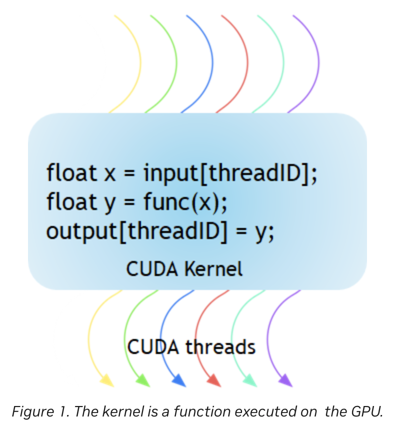
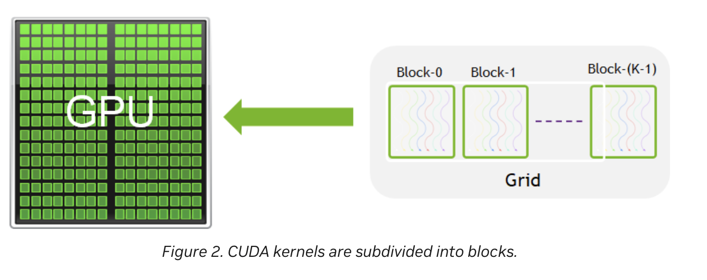
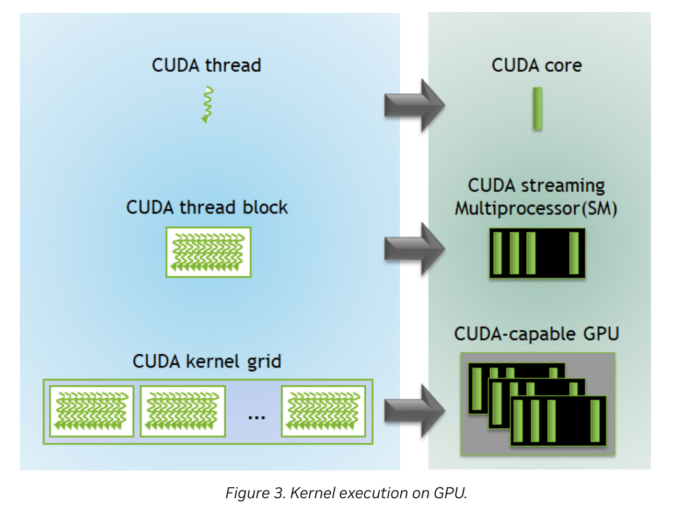
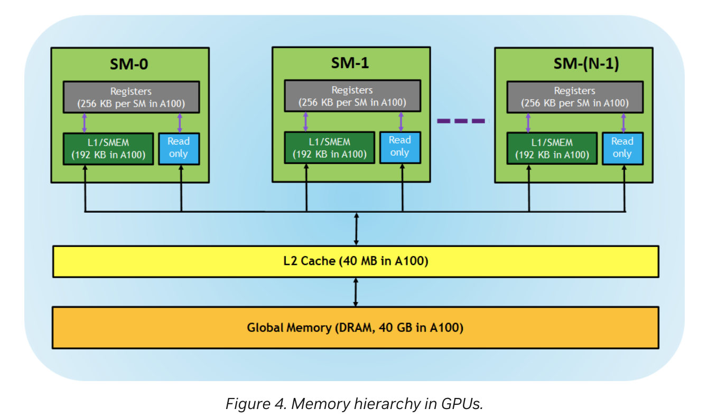

# CUDA Programming Model（CUDA 编程模型）中文译文

原文：[CUDA Refresher: The CUDA Programming Model](https://developer.nvidia.com/blog/cuda-refresher-cuda-programming-model/)，NVIDIA Technical Blog；作者：Pradeep Gupta；发布日期：2020 年 6 月 26 日。

本文依据用户提供的正文翻译，优先使用英文技术术语，首次介绍重要概念时附中文释义，代码标识符保持原样。配图使用用户提供的原文截图；重复的图 2 图注合并为一处。末尾“译注”不属于原文。

## CUDA Programming Model 概述

这是 CUDA Refresher（CUDA 温习系列）的第四篇文章。这个系列面向初级和中级开发者，帮助读者温习 CUDA、相关工具及优化方面的关键概念。

CUDA Programming Model（CUDA 编程模型）提供了对 GPU 架构的抽象，在应用程序与其可能采用的 GPU 硬件实现之间架起桥梁。本文介绍这一模型的主要概念，以及这些概念如何通过 C/C++ 等通用编程语言体现出来。

首先介绍 CUDA Programming Model 中经常使用的两个关键词：host（主机）和 device（设备）。host 指系统中的 CPU，与 CPU 相连的系统内存称为 host memory；GPU 称为 device，与之对应的 GPU 显存称为 device memory。

执行 CUDA 程序通常包含三个主要步骤：

1. 将输入数据从 host memory 复制到 device memory，即 Host-to-Device Transfer（H2D）。
2. 加载并执行 GPU 程序，利用 on-chip cache（片上缓存）提高性能。
3. 将结果从 device memory 复制回 host memory，即 Device-to-Host Transfer（D2H）。

## CUDA Kernel and Thread Hierarchy（核函数与线程层级）

图 1 展示了 CUDA Kernel（核函数）：它是在 GPU 上执行的函数。应用程序中的并行部分，由 K 个不同的 CUDA thread（线程）并行执行 K 次，而不是像普通 C/C++ 函数那样只执行一次。



图 1：Kernel 是在 GPU 上执行的函数。

CUDA Kernel 使用 `__global__` declaration specifier（声明说明符）标记。开发者可以利用 built-in variable（内置变量），为每个 thread 计算唯一的 global thread ID（全局线程编号）。



图 2：CUDA Kernel 的执行任务被划分为 thread block（线程块）。一组 thread 组成一个 CUDA block，多个 block 组成 grid（线程网格）；一次 Kernel 启动以包含多个 block 的 grid 形式执行。

每个 CUDA block 由一个 Streaming Multiprocessor（SM，流式多处理器）执行，通常不能迁移到 GPU 中的其他 SM，原文列出的例外包括 preemption（抢占）、debugging（调试）或 CUDA Dynamic Parallelism（动态并行）。根据 block 需要的资源，一个 SM 可以同时运行多个 CUDA block。每个 Kernel 在一个 device 上执行，而 CUDA 支持在同一个 device 上同时运行多个 Kernel。图 3 展示了 Kernel 执行任务与 GPU 硬件资源之间的映射。



图 3：Kernel 在 GPU 上的执行。图中 CUDA thread 为线程，CUDA core 为计算核心，CUDA thread block 为线程块，CUDA kernel grid 为 Kernel 的线程网格。

CUDA 为 thread 和 block 定义了 built-in 3D variable（内置三维变量）。thread 通过 `threadIdx` 索引，三维索引便于自然地定位 vector（向量）、matrix（矩阵）和 volume（三维体数据）中的元素，从而简化 CUDA 编程。类似地，block 通过内置变量 `blockIdx` 索引。

以下几点值得注意：

- CUDA 架构限制每个 block 的 thread 数量；原文给出的上限是每块 1,024 个 thread。
- Kernel 中可以通过内置变量 `blockDim` 获取 block 的各维大小。
- 同一 block 中的 thread 可以使用内置同步函数 `__syncthreads()` 同步；到达同步点的 thread 需要等待其他参与 thread 也到达，然后才能继续执行。
- Kernel 启动语法 `<<<…>>>` 中指定的 threads per block 和 blocks per grid，可以使用 `int` 或 `dim3` 类型。三个尖括号表示从 host code 发起 device code 调用，也称为 Kernel Launch（核函数启动）。

下面的 Matrix Addition（矩阵相加）示例展示了多维 `blockIdx`、`threadIdx` 以及 `blockDim` 的使用。为了方便索引，示例采用二维 block，x、y 两个方向各有 16 个 thread，因此每块共 256 个 thread。grid 大小由数据规模除以 block 各维大小并向上取整得到。

```cpp
// Kernel：将两个矩阵 MatA 和 MatB 相加。
__global__ void MatAdd(float MatA[N][N], float MatB[N][N],
                      float MatC[N][N])
{
    int i = blockIdx.x * blockDim.x + threadIdx.x;
    int j = blockIdx.y * blockDim.y + threadIdx.y;
    if (i < N && j < N)
        MatC[i][j] = MatA[i][j] + MatB[i][j];
}

// host 侧示意程序：保留原文省略号，省略数据准备与资源管理。
int main()
{
    ...
    // 从 host code 启动矩阵相加 Kernel。
    dim3 threadsPerBlock(16, 16);
    dim3 numBlocks((N + threadsPerBlock.x - 1) / threadsPerBlock.x,
                   (N + threadsPerBlock.y - 1) / threadsPerBlock.y);
    MatAdd<<<numBlocks, threadsPerBlock>>>(MatA, MatB, MatC);
    ...
}
```

## Memory Hierarchy（存储层次结构）

支持 CUDA 的 GPU 具有图 4 所示的 memory hierarchy。



图 4：GPU 的 memory hierarchy。[查看用户提供的局部放大截图](docs/assets/cuda-programming-model/figure-4-memory-hierarchy-detail.png)。

GPU 架构提供以下存储资源：

| English（中文释义） | 原文含义 |
|---|---|
| Register（寄存器） | 每个 thread 私有，分配给一个 thread 的 register 不能被其他 thread 直接访问。编译器决定 register 的使用方式。 |
| L1 Cache / Shared Memory（L1 缓存／共享内存，SMEM） | 每个 SM 都有快速的 on-chip scratchpad（片上暂存空间），可以用于 L1 cache 和 shared memory。同一 block 内的 thread 可以共享 shared memory，同一 SM 上的 block 则共同使用该 SM 提供的物理存储资源。 |
| Read-only Memory（只读存储） | 原文列举了 SM 的 instruction cache（指令缓存）、constant memory（常量存储）、texture memory（纹理存储）和 read-only cache（只读缓存，RO cache），这些只读资源供 Kernel 代码读取。 |
| L2 Cache（L2 缓存） | 由所有 SM 共享，因此每个 block 中的每个 thread 都可以使用。原文以 A100 的 40 MB 与 V100 的 6 MB 作对比。 |
| Global Memory（全局显存） | GPU 的 framebuffer（帧缓冲存储空间），由 device 上的 DRAM（动态随机存取存储器）提供。 |

NVIDIA CUDA 编译器能够很好地优化存储资源的使用；熟练的 CUDA 开发者还可以主动利用这些存储层次，进一步优化程序性能。

## Compute Capability（计算能力）

GPU 的 Compute Capability（计算能力）描述其硬件支持的一般规格和可用功能。应用程序可以在运行时读取这个版本号，判断当前 GPU 支持哪些硬件功能或指令。

每款 GPU 都有一个形如 `X.Y` 的 Compute Capability 版本号：`X` 是 major revision（主要修订版本），`Y` 是 minor revision（次要修订版本）。minor revision 表示架构的增量改进，也可能包含新功能。

如果想了解支持 CUDA 的 device 的 Compute Capability 及其他属性，可以查看 CUDA 示例程序 [deviceQuery](https://github.com/NVIDIA/cuda-samples)。它会枚举系统中 CUDA device 的属性。

## Summary（总结）

CUDA Programming Model 提供 heterogeneous environment（异构计算环境）：host code 在 CPU 上运行 C/C++ 程序，Kernel 则在物理上独立的 GPU device 上执行。该模型还假设 host 和 device 分别维护自己的存储空间，即 host memory 和 device memory。CUDA 代码也支持经由 PCIe 总线在两者之间传输数据。

CUDA 提供多种 built-in variable，并支持灵活的多维索引，使编程更方便。它还提供 register、shared memory 与 L1 cache、L2 cache、global memory 等存储资源；有经验的开发者可以高效利用这些资源来优化 CUDA 程序。

## 译注：读图与术语边界

1. 图 3 是教学示意图，不能理解为一个 thread 始终独占或永久绑定一个 CUDA Core。block 映射到 SM 后，其 thread 以 warp（线程束）组织并调度执行。参见 [CUDA Programming Guide：GPU Hardware Model](https://docs.nvidia.com/cuda/cuda-programming-guide/01-introduction/programming-model.html#gpu-hardware-model)。
2. 图 4 的 256 KB 指一个 A100 SM 的 register file（寄存器堆）总容量，不是一个 register 的容量；192 KB 是图中 L1／SMEM 的物理资源容量，不代表两者各有 192 KB。40 GB、40 MB 等数字是原图所用 A100 配置的示例，不适用于所有 GPU。register 不是 cache，shared memory 也不等于 L1 cache。
3. 原文将 constant memory、texture memory 与 read-only cache 合并介绍，属于概括性分类；例如 constant memory 的底层数据位于 device memory，可由 on-chip cache 加速，并不是全部常量数据都位于 SM 内。参见 [CUDA Programming Guide：Memory Spaces](https://docs.nvidia.com/cuda/cuda-programming-guide/02-basics/writing-cuda-kernels.html)。
4. `Compute Capability` 是硬件能力版本，不是 CUDA Toolkit 的版本；代码中的 `...` 是原文省略内容，不是可直接编译的完整程序。开头的 H2D／执行／D2H 是简化工作流，连续多个核函数可以复用已驻留 GPU 的数据，无需每次都往返复制。
