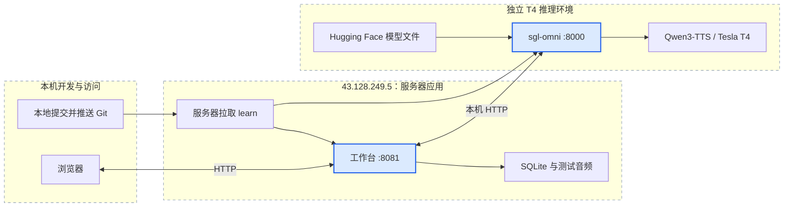

# T4 服务器部署

当前目标服务器：`43.128.249.5`，SSH 用户 `root`、端口 `22`。工作台入口为 `http://43.128.249.5:8081`，按当前使用约定不要求登录。凭据不写入仓库。

本目录使用现有正式 `sgl-omni serve` 入口，提供 T4 的 FP16、Triton 注意力和 eager 执行配置。Ubuntu 24 独立用户空间与 `.venv-cu126` 用于满足较新的系统库和 Python 依赖；不替换宿主系统、驱动或基础 PyTorch 环境。CUDA 13 专用的可选融合内核不安装，相关依赖替换集中保存在 `overrides-cu126.txt` 和 `excludes-cu126.txt`。

<!-- mermaid:id=t4_deployment -->


## 首次安装

服务器仓库路径为 `/root/workspace/sglang-omni`，运行数据在 `/root/data/sglang-omni`。先在本机提交并推送；以下操作在服务器执行：

```bash
cd /root/workspace/sglang-omni
git switch learn
git pull --ff-only origin learn
python3 -m pip install --user uv
bash deploy/t4/setup-runtime.sh
bash deploy/t4/install-inference.sh
```

宿主需提供 `/usr/local/cuda-12.4`（包括兼容驱动用户库和 PTXAS）及可用的 NVIDIA 设备。依赖安装记录保存在 `operations/environment-freeze.txt`；根项目的 CUDA 13 默认依赖不适用于这套 T4 环境，不在其基础 Python 环境执行安装。

模型直接从 Hugging Face 官方仓库获取。本次使用的模型版本为 `fd4b254389122332181a7c3db7f27e918eec64e3`：

```bash
/root/.local/bin/uv tool install huggingface_hub
/root/.local/bin/hf download Qwen/Qwen3-TTS-12Hz-1.7B-Base \
  --revision fd4b254389122332181a7c3db7f27e918eec64e3 \
  --local-dir /root/data/sglang-omni/models/Qwen3-TTS-12Hz-1.7B-Base
/root/.local/bin/hf cache verify Qwen/Qwen3-TTS-12Hz-1.7B-Base \
  --revision fd4b254389122332181a7c3db7f27e918eec64e3 \
  --local-dir /root/data/sglang-omni/models/Qwen3-TTS-12Hz-1.7B-Base \
  --fail-on-missing-files
cd /root/workspace/sglang-omni/projects/tts-workbench
/root/.local/bin/uv sync --frozen
/root/.local/bin/uv tool install supervisor==4.3.0
```

启动和观察：

```bash
cd /root/workspace/sglang-omni
/root/.local/bin/supervisord -c deploy/t4/supervisord.conf
/root/.local/bin/supervisorctl -c deploy/t4/supervisord.conf status
curl --fail http://127.0.0.1:8000/health
curl --fail http://127.0.0.1:8081/healthz
```

Supervisor 在当前实例运行期间管理进程退出与重启。整台 HAI 实例重启后，需要重新执行 `supervisord` 命令；推理入口会恢复其绑定挂载。不要与手动启动的同端口进程同时运行。

## 更新与数据

服务器执行 `git pull --ff-only origin learn` 后，使用以下命令重启对应服务：

```bash
cd /root/workspace/sglang-omni
/root/.local/bin/supervisorctl -c deploy/t4/supervisord.conf restart qwen3-tts
/root/.local/bin/supervisorctl -c deploy/t4/supervisord.conf restart tts-workbench
```

仅修改工作台时只需重启 `tts-workbench`。依赖变化时先停止对应服务，再按上方安装命令更新；推理依赖使用独立环境中的 `uv pip`，工作台使用自身 `uv sync --frozen`。

| 内容 | 路径 |
| --- | --- |
| 模型文件 | `/root/data/sglang-omni/models/Qwen3-TTS-12Hz-1.7B-Base` |
| 推理日志 | `/root/data/sglang-omni/operations/server.log` |
| 工作台日志 | `/root/data/sglang-omni/operations/tts-workbench.log` |
| 任务、请求、GPU、日志索引与音频 | `/root/workspace/sglang-omni/projects/tts-workbench/results/server` |
| 测试素材 | `/root/workspace/sglang-omni/tts_test_data` |

新服务器从新的测试结果库开始；旧服务器的历史任务、日志和生成音频不会随 Git 自动迁移。五个测试单元已包含在仓库中。

工作台仅通过本机 `127.0.0.1:8000` 调用推理服务，对外入口为 `8081`。完整功能与统计口径见 [工作台说明](../../projects/tts-workbench/README.md)。

## 部署验证记录

2026-10-17 在 `43.128.249.5` 实测：公网工作台无需登录可访问，T4 指标及历史图表可读取；Qwen3-TTS 的健康检查返回 200。Hugging Face 模型版本与上方记录一致，13 个文件全部通过官方 CLI 校验。

从 Chrome 工作台创建 `qwen3-tts-1.7b-base-001`，原样使用 `E35_lower_0000` 的 0.68 秒中文参考音频，合成英文 `Your Majesty,`。请求返回 200，生成 49,964 字节、24,000 Hz、单声道 PCM WAV，时长 1.04 秒；已在浏览器点击试听并完成播放。首次请求耗时 31.55 秒，包含首次内核准备，不作为稳态性能结论。

服务请求 ID 为 `speech-c8221a1c-0f98-4e7c-af91-0ba6726d9813`；HTTP 入参来自请求时保存的快照。按此 ID 查询 SQLite 历史匹配 25,007 行，下载结果也为 25,007 行，确认查询覆盖超过页面 20,000 行上限的历史。验证覆盖单句合成与工作台观察功能，未进行整集或长时间负载测试。
