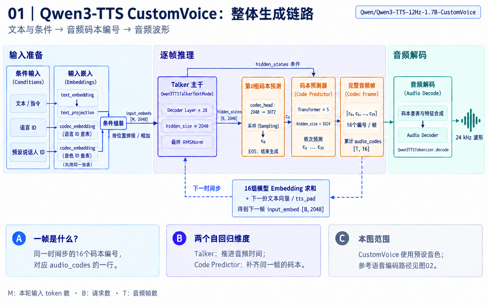
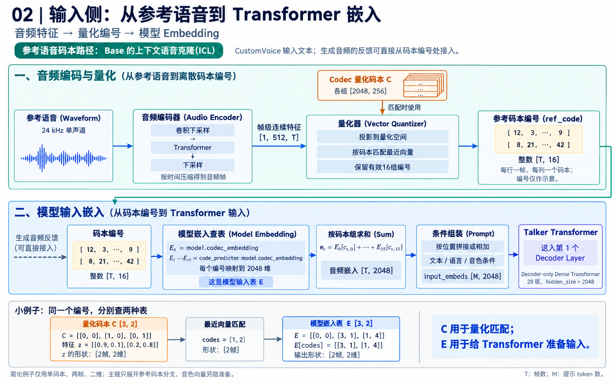
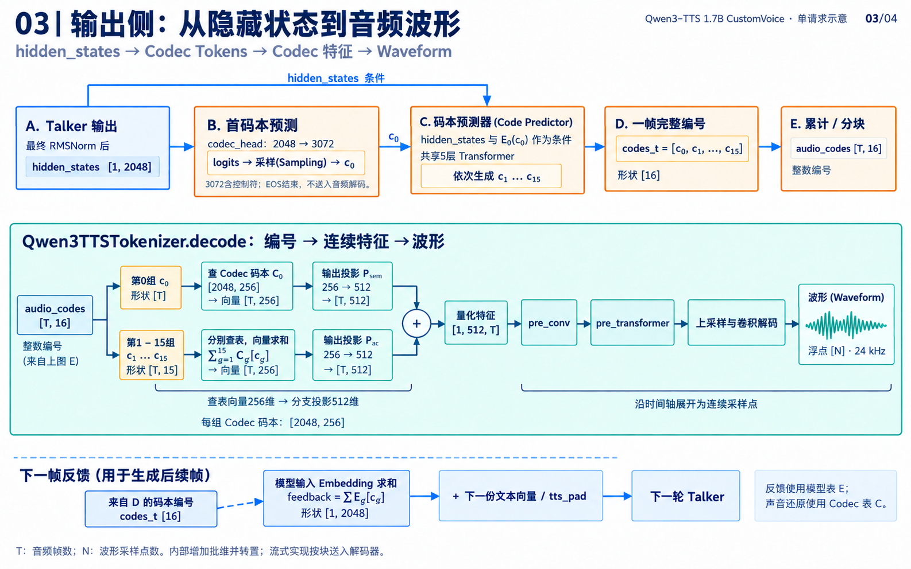
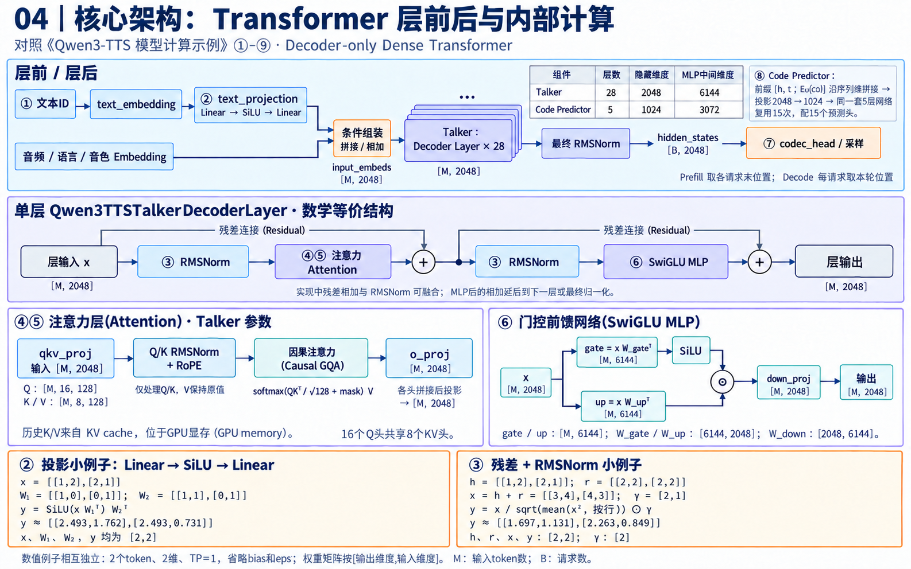

# Qwen3-TTS 技术方案配图

使用内置 imagegen 生成，按当前仓库实现、模型配置及官方音频编解码器源码核对。蓝色表示输入与模型嵌入，靛蓝表示 Transformer，橙色表示码本编号与预测，青绿色表示音频编解码。

## 01 整体生成链路

CustomVoice：文本、语言和预设说话人条件 → Talker → Code Predictor → 完整音频帧 → 音频解码；同时展示下一帧反馈。

[生成与修订提示词](01_overall_flow.prompt.txt)

## 02 参考语音到 Transformer 嵌入

参考语音编码适用于 Base 的上下文语音克隆(ICL)路径。CustomVoice 使用文本和预设音色；已生成音频的反馈从码本编号处接入。

[生成提示词](02_audio_input_embedding.prompt.txt)

## 03 隐藏状态到音频波形

码本编号分为两条用途：查 Codec 码本并解码为波形；查模型嵌入表并准备下一帧输入。图中以 E、D 标签连接跨区域的数据来源。

[生成与修订提示词](03_hidden_states_to_audio.prompt.txt)

## 04 Transformer 核心架构

展开层前投影、层后归一化、残差连接(Residual)、分组查询注意力(GQA)、门控前馈网络(SwiGLU MLP)，并给出两组小张量计算。

[生成与修订提示词](04_transformer_architecture.prompt.txt)

## 阅读约定与来源

- 码本编号是整数索引；Codec 码本 C 与模型输入嵌入表 E 属于不同模块。
- 一帧对应同一时间步的16个码本编号；形状标注省略的批维或转置在图中说明。
- 数值例子用于教学简化，不能将其二维向量或小词表当作真实模型配置。
- [Qwen3-TTS 模型计算示例](../../qwen3_tts_tensor_examples_zh.md)。
- [仓库模型定义](../../../../sglang_omni/models/qwen3_tts/sglang_model.py)。
- [官方12Hz音频编解码器实现](https://github.com/QwenLM/Qwen3-TTS/blob/main/qwen_tts/core/tokenizer_12hz/modeling_qwen3_tts_tokenizer_v2.py)。
- [模型 speech_tokenizer 配置](https://huggingface.co/Qwen/Qwen3-TTS-12Hz-1.7B-CustomVoice/blob/main/speech_tokenizer/config.json)。
- [Transformers v4.57.3 Mimi 编码与量化实现](https://github.com/huggingface/transformers/blob/v4.57.3/src/transformers/models/mimi/modeling_mimi.py)。

验证：已核对图中文字、数据形状与核心连线，并复算图04的两组数值例子。PNG文件完整性及本地链接已检查；环境未安装 pre-commit，未运行该仓库检查。
