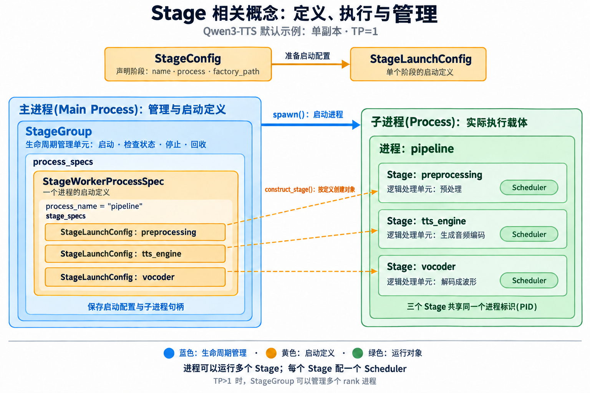
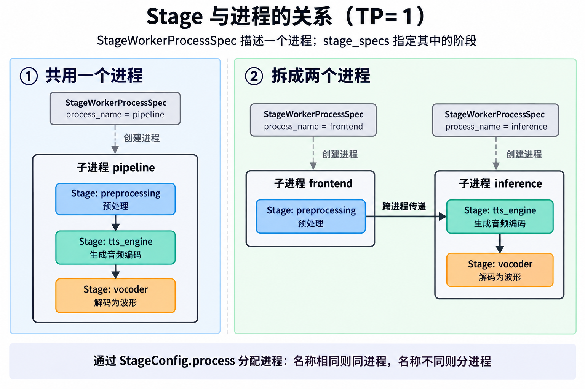

# 1. 基础知识-stage

Stage 是处理请求的阶段对象，运行在 Python 子进程中；StageGroup 在主进程中管理这些子进程的启动、就绪、停止和回收。

## 核心对象与字段

| 对象 | 核心字段 | 职责 |
|---|---|---|
| `StageConfig` | `name`、`process` | 声明阶段名称，以及放在哪个进程 |
| `StageLaunchConfig` | `stage_name`、`factory`、`next_stages` | 单个阶段的启动配置：阶段标识、创建入口、下游阶段 |
| `StageWorkerProcessSpec` | `process_name`、`stage_specs` | 描述一个进程，以及该进程需要创建的阶段配置列表 |
| `StageGroup` | `process_specs` | 管理一组进程，保存启动配置和子进程句柄 |
| `Stage` | `name`、`scheduler`、`get_next` | 接收请求，调用调度器(Scheduler)，将结果交给下游 |

`stage_name` 区分 `preprocessing`、`tts_engine`、`vocoder`；`StageConfig.process` 决定进程分组。
`Stage` 本身没有 `process` 或 `pid` 字段；所属关系由外层的进程配置记录。

## 概念关系：定义、执行与管理



- **黄色：启动定义**。`StageConfig` 声明阶段；`StageLaunchConfig` 定义单个阶段怎么创建；`StageWorkerProcessSpec` 定义一个进程要运行哪些阶段。
- **绿色：实际运行**。进程(Process)是运行载体，Stage 是其中的逻辑处理单元，每个 Stage 配一个调度器(Scheduler)。
- **蓝色：生命周期管理**。StageGroup 根据启动定义，启动、检查和回收进程，保存启动配置与子进程句柄。

```text
StageGroup.process_specs
    └─ StageWorkerProcessSpec：一个进程的启动定义
        └─ stage_specs：多个 StageLaunchConfig
            → construct_stage()：在子进程中创建对应的 Stage
                └─ Scheduler：调度并执行本阶段的计算
```

`StageGroup.spawn()` 启动子进程，子进程中的 `construct_stage()` 创建真正的 Stage 对象。
Stage 是运行时的逻辑处理单元；任务的定义由配置对象描述。图中虚线表示按配置创建对象，不表示请求流转。

## Stage 与进程的关系



- 一个 `StageWorkerProcessSpec` 对应一个操作系统进程(Process)，其中的 `stage_specs` 可以包含多个 `StageLaunchConfig`，再据此创建多个 Stage。
- 当前 Qwen3-TTS 默认三个阶段都配置 `process="pipeline"`：一个 StageGroup 管理一个子进程，子进程内运行三个 Stage，共享同一个进程标识(PID)。
- 在 `TP=1` 时，显式配置相同的 `StageConfig.process` 名称表示同进程，不同名称表示分进程。例如预处理放在 `frontend`，生成和音频解码放在 `inference`。
- 张量并行(Tensor Parallelism, TP)大于 1 时，每个 rank 独占进程；一个 StageGroup 可以管理同一逻辑阶段的多个 rank 进程。

## 从配置到运行对象

```text
主进程：MultiProcessPipelineRunner.start()
    → build_stage_groups()：整理阶段配置和进程布局
    → build_single_stage_spec()：TP=1 时创建 StageLaunchConfig
    → StageWorkerProcessSpec：收集同一进程的阶段配置
    → StageGroup.spawn()：创建并启动子进程
         │
         └─ 子进程：run_process()
              → 遍历 stage_specs
              → construct_stage(spec)：创建每个 Stage
              → Stage.start()：启动阶段
```

上图省略中间调用，重点是：主进程准备启动配置，子进程创建真正的 Stage 对象。
请求处理顺序为 `preprocessing → tts_engine → vocoder`；默认构造顺序为 `preprocessing → vocoder → tts_engine`，两者不同。

## 源码入口

- [阶段与进程配置定义](../../sglang_omni/pipeline/stage_workers.py)：`StageLaunchConfig`、`StageWorkerProcessSpec`、`StageGroup`、`construct_stage()`。
- [进程组构建](../../sglang_omni/pipeline/mp_runner.py)：`build_stage_groups()`、`build_single_stage_spec()`。
- [Qwen3-TTS 默认布局](../../sglang_omni/models/qwen3_tts/config.py)：三个阶段的 `process` 和 `next` 配置。
