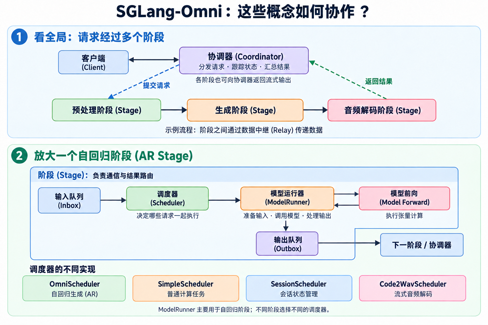

# 2. 流水线概览(Pipeline Overview)

协调器(Coordinator)管理全局请求，阶段(Stage)负责通信，调度器(Scheduler)安排执行，模型运行器(ModelRunner)负责自回归模型的前向执行。以下为所提供《Pipeline Overview》的中文翻译，保留接口名称和设计状态。



图中以语音生成为例；四种调度器是不同实现，并非依次执行的四个步骤。

## 协调器(Coordinator)

`Coordinator` 是全局请求路由器：注册阶段端点(Stage Endpoint)，将新请求发送到入口阶段，接收 `CompleteMessage` 和 `StreamMessage` 事件，并完成客户端的异步结果(Future)或流式响应(Stream)。主要职责：

- 将新请求路由到 `entry_stage`，跟踪请求状态：等待中(pending)、运行中(running)、已完成(completed)、失败(failed)、已中止(aborted)。
- 收集终止阶段(Terminal Stage)的完成结果；当流水线有多个终止阶段，例如 `decode` 和 `code2wav` 时，合并结果。
- 向所有阶段广播中止消息(Abort Message)。

协调器不依赖阶段的具体实现。在张量并行(Tensor Parallelism, TP)阶段组中，它只与 `rank 0` 通信，其他并行进程(Rank)之间的交互留在阶段组内部。

## 阶段(Stage)

`Stage` 是输入输出外壳(IO Shell)，负责所有阶段间通信：接收控制消息、读写数据中继(Relay)中的载荷(Payload)、按需执行多路汇聚(Fan-in)，并将所有可执行工作放入 `scheduler.inbox`。

```python
class Stage:
    def __init__(self, name, control_plane, relay, get_next, input_handler, scheduler, stream_targets, same_gpu_targets):
        self.scheduler = scheduler
```

阶段的职责：

- 通过 ZMQ 接收 `SubmitMessage`、`DataReadyMessage`、`ShutdownMessage` 和性能分析器(Profiler)控制消息；通过协调器的广播通道接收 `AbortMessage`。
- 通过数据中继(Relay)读写完整的 `StagePayload` 对象；在多路汇聚阶段使用 `AggregatedInput` 聚合输入。
- 将普通结果路由到下游阶段或协调器；路由流式数据块(Streaming Chunk)，包括同 GPU 的 CUDA 进程间通信(CUDA IPC)和跨 GPU 的数据中继。
- 持续取出 `scheduler.outbox` 中的输出，并转换为控制平面(Control Plane)消息。

关键约束是：`Stage` 不根据调度器类型编写分支逻辑。`SimpleScheduler`、`OmniScheduler`、按会话保存状态的 `SessionScheduler` 及流式调度器都提供相同的接口。

## 调度器(Scheduler)

所有调度器实现相同的接口，通过输入队列(Inbox)和输出队列(Outbox)与阶段层通信：

```python
class Scheduler:
    inbox: Queue[IncomingMessage]
    outbox: Queue[OutgoingMessage]
    def start(self) -> None: ...
    def stop(self) -> None: ...
    def abort(self, request_id: str) -> None: ...

class IncomingMessage:
    request_id: str
    type: Literal["new_request", "stream_chunk", "stream_done"]
    data: Any

class OutgoingMessage:
    request_id: str
    type: Literal["result", "stream", "error"]
    data: Any
    target: str | None
    metadata: dict[str, Any] | None
```

### 自回归调度器(OmniScheduler)

`OmniScheduler` 用于自回归(Autoregressive, AR)阶段，与 SGLang 上游调度器组合使用。目标是复用 SGLang 的批次选择(Batch Selection)、键值缓存(KV Cache)管理、预填充与解码调度(Prefill/Decode Scheduling)及树缓存(Tree Cache)，同时将 SGLang-Omni 的传输、请求对象和流式行为保留在上游调度器之外。

原文明确不支持重叠调度(Overlap Scheduling)：`OmniScheduler._event_loop_overlap` 拒绝运行，因为该循环会使 `Req.inflight_middle_chunks` 的递减操作滞后一次迭代。

### 简单调度器(SimpleScheduler)

`SimpleScheduler` 用于预处理(Preprocessing)、编码器(Encoder)、聚合(Aggregation)和解码(Decode)等非自回归(Non-AR)阶段。它没有 KV 缓存，也不使用 SGLang 的批处理(Batching)。执行循环如下；对于适合局部批处理(Local Batching)的阶段，它也支持批量计算函数(Batch Compute Function)。

```text
inbox.get() → 计算函数(Compute Function) → outbox.put(结果或错误)
```

### 会话调度器(SessionScheduler)

`SessionScheduler` 服务于按会话(Session)保存状态的阶段。每个请求对应一次会话操作：打开(open)、追加(append)或关闭(close)。阶段为每个会话维护一个游标(Cursor)，保证同一会话的操作按到达顺序执行。

使用 `SessionHooks` 时，每次调用执行一个工作单元(Unit)，多个并发工作线程或执行单元(Worker)服务不同会话。使用 `BatchedSessionHooks` 时，`append_batch` 在一次调用中执行每个就绪会话最早的就绪工作单元；这一次钩子(Hook)调用替代上述并发执行单元。

当就绪会话数少于已打开会话数时，空闲阶段最多等待 `gather_window_ms`，以收集更多追加操作。每个阶段根据自身单次调用耗时下限(Per-call Floor)确定该窗口；值为 0 时直接执行已就绪的工作。

如果某个会话在追加后，其状态大小超过 `max_state_bytes_per_session`，只终止该会话。如果 `append_batch` 抛出异常，则终止本次调用涉及的所有会话；未参与失败调用的会话继续执行。

### 音频解码调度器(Code2WavScheduler)

`Code2WavScheduler` 是流式声码器(Streaming Vocoder)调度器，处理以下消息：

- `new_request`：初始化请求状态。
- `stream_chunk`：累积并解码编码数据块(Code Chunk)。
- `stream_done`：输出剩余音频并产生最终结果。

## 模型运行器(Model Runner)

模型运行器层负责自回归前向路径(AR Forward Path)，设计目标如下。公共基础运行器(Base Runner)负责 `ForwardBatch` 构建、采样(Sampling)、未归一化分数(Logit)处理、重复惩罚(Repetition Penalty)、输出处理，以及转换为调度器输出。

```text
ForwardBatch → 前置/自定义前向钩子 → 模型前向(Model Forward) → 后置钩子 → 输出处理
```

### 思考模型运行器(ThinkerModelRunner)

`ThinkerModelRunner` 用于 Qwen-omni 的 Thinker 类自回归模型。它的模型专属职责是准备前向批次(Forward Batch)：在模型前向执行前，注入图像、视频、音频以及 deepstack 输入等多模态嵌入(Multimodal Embedding)。

### 反馈式自回归模型运行器(FeedbackARModelRunner)

重构设计提出共享的 `FeedbackARModelRunner` 角色，面向下一次解码依赖同一运行器内上一步反馈的自回归模型。Qwen3-Omni Talker 和 Fish Audio S2-Pro 都符合这种结构；Qwen3 已在其 Talker 运行器中实现这一模式。

该抽象仅覆盖内部闭合的反馈循环(Feedback Loop)：前向执行前，将上一步反馈写入模型缓冲区(Buffer)；在模型 `forward()` 中运行自回归主干(AR Backbone)和辅助头(Secondary Head)；前向执行后提取码本(Codebook)输出和反馈张量(Feedback Tensor)；将流式输出或最终结果推入调度器输出队列。

生产者和消费者位于不同调度器、通过数据中继通信的跨阶段反馈(Cross-stage Feedback)，不属于该运行器的职责。设计将模型专属的反馈行为归入一个小型策略(Strategy)：

```python
class FeedbackStrategy:
    def write_buffers(self, model, schedule_batch, requests) -> None: ...
    def extract_output(self, model, schedule_batch, requests, outbox) -> None: ...
    def prefill_forward(self, tp_worker, forward_batch, ...) -> object | None: ...
```
