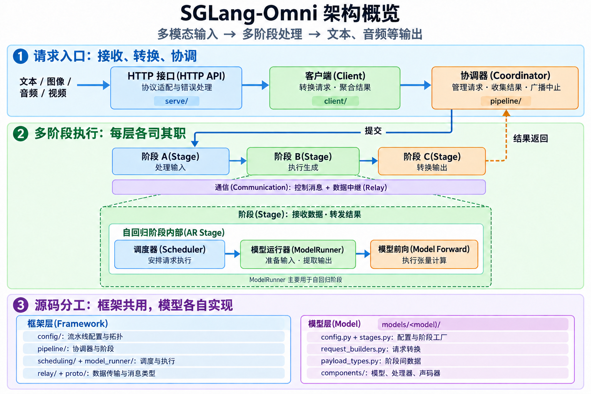
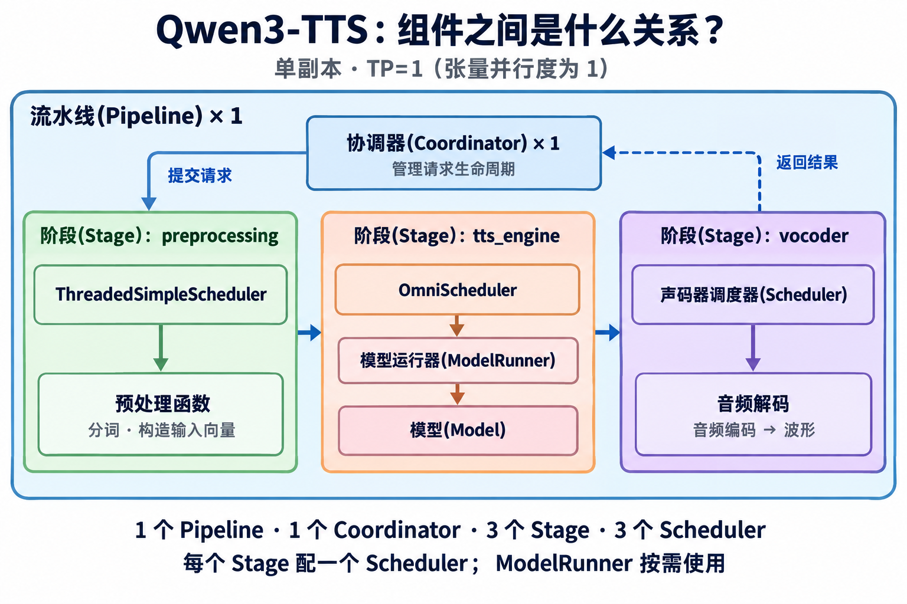

# 3. 架构概览(Architecture)

SGLang-Omni 是全模态模型(Omni Model)的多阶段运行时(Multi-stage Runtime)。这类模型可以接收文本、图像、音频和视频的混合输入，并输出文本、音频或其他模态(Modality)的内容。

## 系统概览(System Overview)



```text
HTTP API → Client → Coordinator → Stage → Scheduler → ModelRunner → 模型前向(Model Forward)
```

| 层级(Layer) | 职责(Duty) |
|---|---|
| [HTTP 接口(HTTP API)](../developer_reference/apiserver_design.md) | 与 OpenAI 兼容的请求和响应结构(Schema)、服务器发送事件(SSE)封装、HTTP 错误处理 |
| [客户端(Client)](../developer_reference/apiserver_design.md) | 将 `GenerateRequest` 转换为 `OmniRequest`、聚合结果、编码音频 |
| [协调器(Coordinator)](../developer_reference/pipeline.md) | 管理请求生命周期(Request Lifecycle)、向入口阶段提交请求、收集终止阶段结果、广播中止消息 |
| [阶段(Stage)](../developer_reference/pipeline.md) | 控制平面输入输出(Control-plane IO)、数据中继输入输出(Relay IO)、多路汇聚(Fan-in)、流式路由(Stream Routing)、衔接调度器输入与输出队列(Inbox/Outbox) |
| [调度器(Scheduler)](../developer_reference/pipeline.md) | 执行各阶段的执行循环(Execution Loop)，并将失败信息传递到阶段的输出队列 |
| [模型运行器(ModelRunner)](../developer_reference/pipeline.md) | 准备自回归前向执行(AR Forward)、分派模型前向调用、提取输出 |
| [通信(Communication)](../developer_reference/communication.md) | 阶段之间的控制平面消息(Control-plane Message)和数据中继传输(Relay Data Transfer) |
| [语音合成集成(TTS Integration)](../developer_reference/tts_model_integration.md) | 添加语音合成模型系列(TTS Model Family)时的检查清单(Checklist)和生命周期规则 |

具体设计细节请参阅各层对应的文档。流水线相关概念的中文介绍和科普图见[流水线概览(Pipeline Overview)](<2. 流水线概览-Pipeline Overview.md>)。

## 组件关系(Component Relationships)

以当前 Qwen3-TTS 单副本、张量并行(Tensor Parallelism, TP)=1 的配置为例：

| 对象关系 | 数量关系 | 说明 |
|---|---|---|
| Pipeline → Coordinator | 1:1 | 一条流水线配一个协调器，管理请求生命周期 |
| Pipeline → Stage | 1:N | 一条流水线包含多个处理阶段 |
| Stage → Scheduler | 1:1 | 每个阶段配一个调度器实例，具体实现可以不同 |
| Scheduler → ModelRunner | 按需使用 | 自回归推理通过模型运行器执行；预处理可以直接调用函数 |

系统概览中的 Scheduler 就是各 Stage 内部的调度器。Coordinator 通过 Stage 与其交互。



```text
Pipeline
├─ Coordinator：管理整个请求的生命周期
├─ Stage("preprocessing")
│   └─ ThreadedSimpleScheduler → 预处理函数
├─ Stage("tts_engine")
│   └─ OmniScheduler → ModelRunner → 模型
└─ Stage("vocoder")
    └─ 声码器调度器 → 音频解码
```

当前共有 **1 个 Pipeline、1 个 Coordinator、3 个 Stage、3 个 Scheduler**；ModelRunner 用于 `tts_engine`。
图中框的嵌套表示组件组成，箭头表示请求流转或调用；它不表示进程(Process)或 GPU 的分配。

## 目录布局(Directory Layout)

```text
sglang_omni/
├─ pipeline/       阶段间编排(Orchestration)、阶段、协调器与进程
├─ scheduling/     调度器循环及输入/输出队列的消息类型
├─ model_runner/   自回归阶段共享的模型运行器抽象
├─ models/         模型专属配置、阶段、请求构建器和模块
├─ config/         PipelineConfig、StageConfig、配置管理器与拓扑(Topology)
├─ relay/          数据传输后端(Data Transfer Backend)
├─ serve/          HTTP 服务器与 OpenAI 兼容接口适配器(API Adapter)
├─ client/         接口适配器使用的内部客户端
└─ proto/          请求、载荷(Payload)、阶段和控制平面的消息类型
```

## 模型目录约定(Model Directory Convention)

模型专属代码应放在 `sglang_omni/models/<model>/` 下。推荐布局如下：

```text
models/<model>/
├─ config.py           PipelineConfig 子类与 StageConfig 列表
├─ stages.py           阶段工厂(Stage Factory)
├─ routing.py          可选的数据驱动路由辅助函数(Data-driven Routing Helper)
├─ request_builders.py 阶段间载荷转换(Payload Transform)
├─ payload_types.py    带类型定义的模型专属载荷状态
├─ callbacks.py        按需提供反馈回调(Feedback Callback)或策略(Strategy)
└─ components/         模型模块、处理器(Processor)、声码器(Vocoder)、适配器(Adapter)
```

这里只有模型自身的行为。`Stage`、`Coordinator`、调度器、模型运行器基类(Model-runner Base)、数据中继(Relay)、运行时准备(Runtime Prep)和运行器(Runner)仍由框架负责。

以 Qwen3-TTS 为例：`config.py` 定义阶段连接与工厂路径，`stages.py` 创建调度器并绑定处理函数，`request_builders.py` 完成请求数据适配。调度器类本身可以定义在框架或模型的其他文件中。
