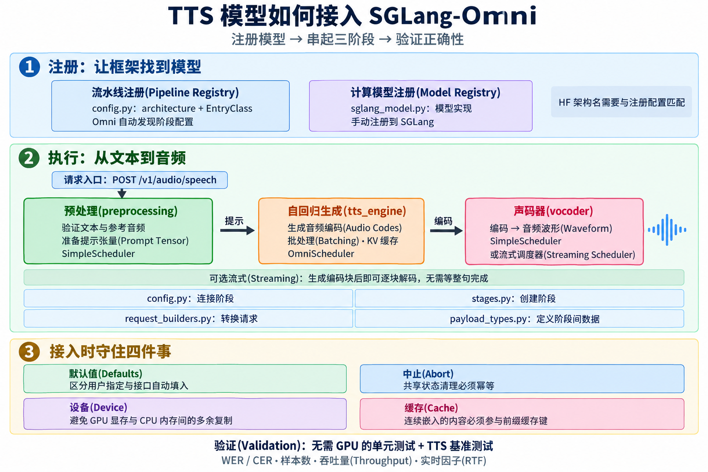

# 4. 语音合成模型集成(TTS Model Integration)

本文介绍如何添加新的语音合成模型系列(TTS Model Family)，以原生支持 `/v1/audio/speech` 服务。建议先阅读[架构概览(Architecture)](<3. 架构概览-Architecture.md>)，了解阶段(Stage)、调度器(Scheduler)和协调器(Coordinator)的整体关系；本文只介绍 TTS 特有的部分。



## 工作顺序(Order of Work)

1. 确定 Hugging Face 架构字符串(HF Architecture String)，即 `config.json` 中的 `architectures[0]`。
2. 创建 `sglang_omni/models/<name>/`，包含 `__init__.py` 和 `config.py`。在 `PipelineConfig` 子类上设置 `architecture`，并导出 `EntryClass`，供注册表(Registry)发现模型。
3. 如果标准 `transformers` 不支持上游 HF 配置，在模块导入时或自回归阶段工厂(AR Factory)中调用 `AutoConfig.register("<model_type>", <Config>)`。
4. 在 `sglang_model.py` 中实现 SGLang 模型类，也可以像 Higgs 一样拆分文件；随后在 `sglang_omni/model_runner/sglang_model_runner.py::_register_omni_model` 中增加注册代码，使 SGLang 能解析该架构。
5. 在 `stages.py` 中实现三个阶段工厂(Stage Factory)。自回归阶段工厂通过 `build_sglang_server_args` 构建服务参数，传给 `create_sglang_infrastructure`，最后返回 `OmniScheduler`。
6. 编写 `request_builders.py` 和 `payload_types.py`。所有涉及共享状态的调度器，都要接入中止清理(Abort Cleanup)逻辑。
7. 添加 `examples/configs/<name>.yaml`，并将模型列入 [TTS 使用文档](../basic_usage/tts.md)。
8. 添加文末列出的、无需 GPU 的单元测试(Unit Test)。

## 文件布局(Layout)

新模型放在 `sglang_omni/models/<name>/` 下。大多数 TTS 模型包含以下文件：

```text
models/<name>/
├─ __init__.py         包标识；此处的子包会被自动发现
├─ config.py           PipelineConfig 子类、阶段列表和 EntryClass
├─ stages.py           StageConfig.factory 引用的工厂函数
├─ request_builders.py 将传入请求转换为调度器输入
├─ payload_types.py    阶段之间传递的带类型定义的状态
├─ sglang_model.py     以 HF 架构名称注册的 SGLang 模型类
└─ model_runner.py     自定义自回归运行器，仅在默认实现不适用时需要
```

并非每个模型都需要所有文件。Higgs 将模型拆为 `model.py` 和 `modeling.py`；Voxtral 将流水线子模块放在 `pipeline/` 下。可以采用适合模型的组织方式，但应将模型专属代码留在模型目录内。

## 流水线结构(Pipeline Shape)

最小可用流水线包含三个阶段。Qwen3-TTS、Voxtral-TTS 和 S2-Pro 都采用这一结构；Qwen3-TTS 和 S2-Pro 将自回归阶段命名为 `tts_engine`，Voxtral 则使用对应的名称 `tts_generation`。

1. **预处理(preprocessing)**：验证请求、获取参考数据并进行标记化(Tokenization)、构建提示状态(Prompt State)。将较重的 CPU/GPU 工作放在这里，避免阻塞自回归循环(AR Loop)。
2. **语音生成(tts_engine)**：自回归生成音频标记(Audio Token)或编解码器标记(Codec Token)。需要 SGLang 的键值缓存(KV Cache)、批处理(Batching)、中止处理和请求限制时，使用 `OmniScheduler`。只有前向计算确实包含模型专属逻辑时，才使用自定义模型运行器(Model Runner)。
3. **声码器(vocoder)**：将编码转换为波形(Codes-to-waveform)。带有 `batch_compute_fn` 的 `SimpleScheduler` 可以处理大多数批量声码器；如果需要在生成结束前向客户端发送音频，则使用流式调度器(Streaming Scheduler)。

仓库中还有两种值得了解的变体：

- 如果每个请求需要在自回归设备(AR Device)上执行一次较重的编码器，可在预处理与 `tts_engine` 之间增加 **音频编码器(audio_encoder)** 阶段。Higgs TTS 用它处理多码本参考嵌入(Multi-codebook Reference Embedding)。
- 如果生成引擎需要逐块向声码器发送数据，在引擎的 `StageConfig` 中设置 `stream_to=["vocoder"]`，并在声码器的 `StageConfig` 中设置 `can_accept_stream_before_payload=True`。可参考 S2-Pro。

在 `config.py` 中以声明式配置(Declarative Configuration)连接上述部分，包括阶段顺序、终止阶段标记(Terminal Flag)、GPU 放置(GPU Placement)和多路分发(Fan-out)。随后在模块级导出 `EntryClass = YourPipelineConfig`，并在类上设置 `architecture: ClassVar[str] = "<HFArch>"`。`sglang_omni/models/registry.py` 会遍历模型目录的所有子包，发现各自的 `EntryClass`，再将其 `architecture` 属性与模型的 HF 配置匹配；无需手动维护模型列表。

代码能够运行后，添加可直接启动的 `examples/configs/<name>.yaml`，并更新 [TTS 使用文档](../basic_usage/tts.md)，让用户可以通过 `sgl-omni serve --config` 启动模型。

### 接入 SGLang(SGLang Wiring)

`tts_engine` 工厂需要在指定 GPU 上创建 SGLang 工作实例(Worker)。两个共享辅助函数负责主要工作：

- `sglang_omni.scheduling.sglang_backend` 中的 `build_sglang_server_args(checkpoint_dir, ...)`：构建服务参数。
- `sglang_omni.scheduling.bootstrap` 中的 `create_sglang_infrastructure(server_args, gpu_id, *, model_arch_override=...)`：返回 `OmniScheduler` 所需的 `(model_worker, tree_cache, req_to_token_pool, token_to_kv_pool_allocator, model_config)` 元组。

所有 GPU 阶段工厂，包括生成引擎、编码器和声码器，都必须声明 `device: str | None = None, gpu_id: int | None = None`，并通过 `sglang_omni.utils.device.resolve_concrete_device` 解析。不要硬编码 `"cuda"`，也不要只读取 `gpu_id`。接口约定及其遍历检查测试见[配置文档](../developer_reference/config.md)的“设备与 GPU 放置约定(Device and GPU Placement Contract)”小节。

以下两项仍需手动接入：

- 在 `sglang_omni/model_runner/sglang_model_runner.py::_register_omni_model` 中，将模型类加入 `ModelRegistry.models[...]`。如果 HF 架构字符串与注册的类名不一致，将注册时使用的同一个键传给 `model_arch_override`。
- 如果上游权重无法直接加载到 SGLang 模块中，添加 `weight_loader.py`，可参考 Higgs 的 `DiscreteWeightMapper`。大多数模型不需要这一步。

## 请求从哪里进入(Where the Request Comes In)

`POST /v1/audio/speech` 使用 `sglang_omni/serve/speech_service.py::SpeechRequestValidator` 验证 OpenAI 格式的请求载荷(Payload)，随后转换为 `GenerateRequest`。请求进入流水线后，由模型的请求构建器(Request Builder)转换为自回归调度器需要的输入。这一边界容易出现两个问题：

- **接口默认值悄悄覆盖模型默认值。** HTTP 层会填入一套统一的采样默认值(Sampling Default)，原文中当前使用的是 S2-Pro 的值。对于其他模型，这些值看起来与用户显式指定的值完全相同。应在请求中传递 `explicit_generation_params` 列表或等价信息，让请求构建器区分“用户指定”和“接口自动填入”。其他由接口提供默认值的字段也需要同样处理。
- **输入格式不统一。** 客户端可能通过 `input`、`text`，甚至聊天式结构传递文本；参考数据也可能是 `ref_audio` + `ref_text`，或者 `references[]` 列表。在请求构建器中统一所支持的输入格式，并验证必需的参考数据。将这些逻辑放在自回归阶段之外，让错误请求在访问 GPU 前就失败。

请求构建器应向调度器提供带类型定义的数据类(Dataclass)，而不是任意结构的字典；可参考各模型的 `payload_types.py`。自回归阶段会在每一步读取这些字段。

## 调度器约定(Scheduler Contracts)

所有调度器提供统一的方法和两个队列，阶段代码依赖这一接口：

```text
inbox: Queue[IncomingMessage]
outbox: Queue[OutgoingMessage]
start() -> None
stop() -> None
abort(request_id: str) -> None
```

- `SimpleScheduler`：执行单个可调用对象(Callable)，可通过 `batch_compute_fn` 支持批处理，适合预处理和大多数声码器。
- `OmniScheduler`：封装 SGLang 的调度方法、KV 缓存和请求限制机制，用于自回归生成。
- 自定义调度器(Custom Scheduler)：用于前两者不适用的情况，例如有状态流式声码器(Stateful Streaming Vocoder)、自定义反标记器(Detokenizer)。

容易遗漏的是**中止清理**。凡是在调度器外部按 `request_id` 保存的状态，例如从预处理传给自回归阶段的临时张量、会话句柄(Session Handle)或参考缓存(Reference Cache)，都必须覆盖以下三个清理路径：

- 预处理阶段在交接之前被中止。
- 自回归阶段被中止，而其请求构建器尚未消费交接数据。
- 请求已经被中止，预处理才完成，因此结果被直接丢弃。

将同一个清理函数作为 `abort_callback` 接入所有涉及共享状态的调度器，并保证它具有幂等性(Idempotency)：按照设计，同一个请求 ID 的清理函数可能被调用多次。

## 张量与设备(Tensors and Devices)

在确实需要 CPU 数据之前，让张量(Tensor)留在其生成设备上。常见错误是在请求构建器中“为了保险”调用 `.cpu()`：每个请求都会付出一次同步(Synchronization)成本，将数据从 GPU 显存(GPU Memory)复制到 CPU 内存(CPU Memory)，随后自回归运行器还得将它搬回 GPU 显存。

- 预处理应直接按自回归阶段使用的设备和数据类型(Device/Dtype)创建提示张量与参考张量，或者在交接给解码阶段之前，仅统一转换一次。
- 调度器请求数据应携带已统一设备和数据类型的设备张量(Device Tensor)。除非下游明确在 CPU 上处理，否则不要在自回归请求数据中保存 CPU 内存副本。
- 不需要梯度时，分离张量与计算图(Detach)。仅在明确的所有权边界(Ownership Boundary)进行类型转换，例如预处理输出、反馈缓冲区写入，或最终的声码器/HTTP 序列化(Serialization)。
- 为生成元数据(Metadata)而将数据复制到 CPU 内存，例如计算稳定的缓存键哈希(Cache-key Hash)，应只产生元数据；不要用 CPU 内存副本替换预填充/解码(Prefill/Decode)使用的设备张量。

另一个陷阱是：如果前缀中包含插入标记序列(Token Stream)的连续嵌入(Continuous Embedding)，例如 Higgs 和 Qwen3-TTS，**基数树缓存(Radix Cache)的键必须由嵌入内容决定**。否则，不同提示即使只是碰巧使用了相同的占位标记 ID(Placeholder Token ID)，也会错误地命中同一份 KV 前缀缓存，导致一个用户的音频混入另一个用户的结果。

## 提交评审前的测试(What to Test Before Review)

添加无需 GPU 的单元测试：请求边界(Request Boundary)覆盖采样默认值保留与必需输入验证；调度器请求数据(Scheduler Request Data)覆盖设备与数据类型的不变条件(Device/Dtype Invariant)、上述中止清理竞态路径(Race Path)；阶段内部行为(Stage-local Behavior)覆盖所选声码器的批处理或流式行为。

端到端质量(End-to-end Quality)使用共享 TTS 基准测试(Benchmark)评估：

```bash
python -m benchmarks.eval.benchmark_tts_seedtts --help
```

报告词错误率(WER)、字符错误率(CER)、样本数(Sample Count)、吞吐量(Throughput)和平均实时因子(`rtf_mean`)。如果模型在某种语言或某个数据划分(Split)上表现落后，应简要说明可能原因，例如采样配置、编解码器/声码器版本、文本规范化(Text Normalization)或评测设置，而不是只留下一个数字。
