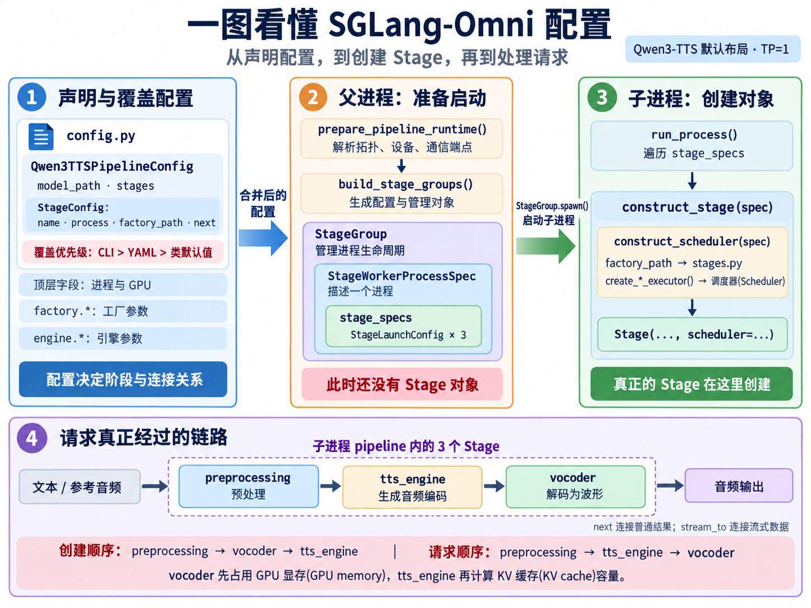

# 5. 配置(Config)

本文翻译[配置原文](../developer_reference/config.md)，[代码示例](<5. 配置-Config-示例.md>)单独收录。科普图以 Qwen3-TTS 默认的张量并行(Tensor Parallelism, TP)=1 配置为例。

SGLang-Omni 使用声明式配置(Declarative Config)，连接模型专属的流水线定义与模型无关的运行时(Runtime)。`PipelineConfig` 描述整条流水线：模型路径、阶段列表、通信端点(Endpoint)和数据中继后端(Relay Backend)；`StageConfig` 描述单个逻辑阶段：如何构建、在哪里运行、普通结果发往哪里，以及是否参与多路汇聚(Fan-in)或流式传输(Streaming)。

配置层刻意保持静态，让拓扑(Topology)、设备放置(Placement)和阶段构建方式在启动前就明确。请求执行期间的行为由阶段(Stage)、调度器(Scheduler)、模型运行器(Model Runner)及模型专属载荷(Payload)逻辑负责。

## 声明与参数分组(Declaration and Consumer Groups)

模型的 `config.py` 使用 `PipelineConfig` 和 `StageConfig` 声明流水线。哪些阶段存在、怎样路由、请求从哪里进入，只在这里定义；YAML 和命令行(CLI)可以覆盖这些阶段的设置，但不能增删阶段。非 TP 阶段必须显式声明 `process`，相同值表示共用一个操作系统进程(OS Process)，可参考 `Qwen3OmniSpeechColocatedPipelineConfig`。

| 参数组 | 使用方(Consumer) | 示例 |
|---|---|---|
| 阶段顶层字段 | 父进程：设备放置、进程规划与连接 | `gpu`、`tp_size`、`process`、`gpu_memory_fraction` |
| `engine.*` | SGLang `ServerArgs`，仅限 `EngineStageConfig` | `mem_fraction_static`、`max_running_requests`、`disable_cuda_graph` |
| `factory.*` | 阶段工厂(Stage Factory)的函数签名 | `dtype`、`max_seq_len`、`max_concurrency`、`enable_async_decode` |

各参数组声明常用字段并提前验证；其他键原样透传，由使用方决定是否接受，入口不对未知键进行格式校验。`factory.*` 按原字段名传给工厂；`engine.*` 放入 `server_args_overrides` 字典交给 SGLang。原来的 `factory_args` 现在写为 `factory.*`，例如 `factory.num_steps: 4`；工厂不接受的参数会在阶段构建时报错。

## 设置参数：YAML 与命令行(Setting Values)

两种写法使用同一套配置路径：YAML 在 `stages:` 下按阶段名设置；CLI 使用 `--阶段名.字段`，省略 `stages.` 前缀。YAML 按名称合并，未指定的字段保留模型默认值；阶段名不存在时会报错，并列出可用名称。完整命令见[示例附页](<5. 配置-Config-示例.md>)。

CLI 文本按已声明字段的类型转换；自由字段使用 YAML 标量(Scalar)解析，例如 `true` → 布尔值、`7` → 整数。**CLI 优先于 YAML；同一优先级重复写入同一路径会报错**，不会静默采用最后一个值。

共享配置 `shared:` 通过选择器(Selector)为多个阶段赋值，解析前展开为每个匹配阶段的配置补丁(Patch)。可用 `stages: [...]` 或 `engine: true` 选择阶段，并用 `exclude: [...]` 排除。`stages:` 中的显式设置或阶段点号参数优先于共享配置；两个 `shared` 条目写入同一叶子字段会冲突。

广播参数(Broadcast Flag) `--mem-fraction-static 0.7` 为所有 SGLang 引擎阶段设置 `engine.mem_fraction_static`，这是保留的唯一便捷广播参数；阶段点号参数可覆盖它，不视为冲突。`sgl-omni config resolve --show config|diff|provenance` 可查看配置、差异或来源，其中竖线表示三选一；`sgl-omni config explain PATH` 可查看某个值来自哪里、覆盖了什么。两者与 `serve` 使用相同的合并逻辑。

## 阶段配置(StageConfig)字段

| 字段 | 类型 | 默认值 | 含义 |
|---|---|---|---|
| `name` | `str` | 必填 | 唯一阶段标识，由配置类定义；配置文件按名称定位，不能重命名 |
| `factory_path` | `str` | 必填 | 阶段工厂的点分导入路径 |
| `engine` | `EngineArgs` 或 `None` | `None` | 覆盖 SGLang `ServerArgs`；仅 `EngineStageConfig` 支持，在其他阶段设置会产生路径错误 |
| `factory` | `FactoryArgs` | 空 | 按字段名传给工厂的关键字参数(Kwargs)，未知键透传 |
| `next` | `str`、`list[str]` 或 `None` | `None` | 普通结果的静态下游阶段 |
| `terminal` | `bool` | `False` | 是否为终止阶段，结果发送给协调器(Coordinator) |
| `route_fn` | `str` 或 `None` | `None` | 按请求选择下游的函数路径；接收 `(request_id, stage_output)`，返回阶段名或名称列表 |
| `gpu` | `int`、`list[int]` 或 `None` | `None` | 阶段 GPU 编号；`None` 表示 CPU 放置，列表用于 TP 各并行进程(Rank) |
| `tp_size` | `int` | `1` | TP 的 Rank 数；`gpu` 为列表时须等于 `len(gpu)` |
| `gpu_memory_fraction` | `float` 或 `None` | `None` | 每个阶段 Rank 占物理 GPU 总显存(GPU Memory)的预算比例；多个进程共享同一 GPU 时，各阶段必须显式设置 |
| `process` | `str` 或 `None` | `None` | 非 TP 阶段必填，同名阶段共用一个 OS 进程；TP 阶段可选，作为 `{process}_tp{rank}` 的前缀，未设置则使用阶段名 |
| `env` | `dict[str, str]` | `{}` | 工作进程(Worker Process)启动时应用的阶段环境变量默认值，不覆盖已有 `os.environ` |
| `wait_for` | `list[str]` 或 `None` | `None` | 执行请求前需要等待的上游阶段 |
| `wait_for_fn` | `str` 或 `None` | `None` | 按请求选择汇聚来源的函数路径 |
| `merge_fn` | `str` 或 `None` | `None` | 多路汇聚的合并函数路径；设置 `wait_for` 时必填 |
| `stream_to` | `list[str]` | `[]` | 所有可能流式目标的静态超集(Superset)，传递隐藏状态(Hidden State)、编解码器编码(Codec Code)等数据块 |
| `stream_done_to_fn` | `str` 或 `None` | `None` | 按请求选择流结束通知目标的函数路径 |
| `project_payload` | `dict[str, str]` | `{}` | 目标阶段到载荷投影函数(Projection Function)路径的映射，在写入下游载荷前调用 |
| `comm` | `CommConfig` 或 `None` | `None` | 阶段通信池(Communication Pool)及 Mooncake 参数 |

路由规则：`next` 与 `terminal=True` 必须且只能设置一个；已声明 `next` 的阶段可用 `route_fn` 按请求覆盖路由。`wait_for` 保留所有可能上游，`wait_for_fn` 只选择当前请求的子集；即使设置了 `stream_done_to_fn`，`stream_to` 仍需保留所有可能流式目标，供运行时准备推导接收方。

## 流水线配置(PipelineConfig)字段

| 字段 | 类型 | 默认值 | 含义 |
|---|---|---|---|
| `model_path` | `str` | 必填 | Hugging Face 模型 ID 或本地检查点(Checkpoint)路径 |
| `stages` | `list[StageConfig]` | 必填 | 阶段定义，配置文件只能按名称覆盖字段，不能增删阶段 |
| `name` | `str` 或 `None` | `model_path` | 流水线名称，用于报告和运行时标识 |
| `entry_stage` | `str` 或 `None` | 第一个阶段 | 入口不是第一个阶段时由配置类声明，不能通过 YAML 或 CLI 设置 |
| `fused_stages` | `list[list[str]]` | `[]` | 在同一运行时进程内放置的相邻线性阶段组 |
| `env_defaults` | `dict[str, str]` | `{}` | 导入阶段工厂前应用的环境变量默认值，已有进程环境变量优先 |
| `mps` | `off`、`on` 或 `auto` | `off` | 符合条件的同 GPU 工作进程使用原生 CUDA 多进程服务(MPS)的策略 |
| `endpoints` | `EndpointsConfig` | IPC 默认值 | 进程间通信(Inter-process Communication, IPC)端点的分配设置 |
| `placement` | `PlacementConfig` | 默认配置 | 设备放置限制，例如 `max_total_gpu_memory_fraction_per_gpu` |
| `terminal_stages_fn` | `str` 或 `None` | `None` | 按请求确定终止阶段的函数路径 |
| `config_cls` | `str` | 类名 | 自动保存，供加载已保存配置时使用 |

模型配置可声明以下类级钩子(Hook)：

- `stage_config_types: ClassVar[dict[str, type[StageConfig]]]`：指定各阶段使用的配置子类，配置路径按该类型解析；映射为 `EngineStageConfig` 才支持 `engine.*`。
- `stage_factory_kwargs(stage_name)`：通过代码传给工厂的构造参数，用于组件连接；用户同名 `factory.*` 设置优先。
- `tensor_parallel_server_args_overrides(stage_name, tp_size)` / `topology_gated_custom_all_reduce_stages()`：启动时根据解析后的 TP 拓扑确定引擎覆盖参数。

`resolved_entry_stage`、`terminal_stages`、`gpu_placement` 从阶段定义推导，无需手动维护。阶段融合(Stage Fusion)配置 `fused_stages` 为运行时准备增加同进程约束，仍保留各个普通 `Stage`，不会创建合成调度器；符合条件的连接可使用进程内分发(Local Dispatch)。每组须相邻、线性、非 TP，最多使用一张 GPU。

## 参数如何传给工厂(How Values Reach a Factory)

两条参数通道在父进程解析，进入工作进程后再按工厂函数签名应用：作者通道为 `PipelineConfig.stage_factory_kwargs(name)`；配置通道为按字段传入的 `stage.factory.*`，以及打包到 `server_args_overrides` 的 `stage.engine.*`。配置通道逐键覆盖作者通道，`server_args_overrides` 也按键合并；工厂不接受的配置参数会在构建时报错。

标准参数 `model_path`、`gpu_id`、`total_gpu_memory_fraction` 仅在工厂签名声明时注入；`gpu_id` 由设备放置逻辑负责，不能从作者通道设置。

### 设备与 GPU 放置约定(Device and GPU Placement Contract)

父进程根据 `stage.gpu` 或副本进程的 `processes.<name>.replica_devices` 确定 GPU，通过 `gpu_id` 传给工厂。`device` 只表示设备类型：`cpu` 留在 CPU，`cuda` / `npu` 须匹配主机平台，不能携带编号；`cuda:1`、`factory.gpu_id` 以及 [`PLACEMENT_OWNED_FACTORY_KWARGS`](../../sglang_omni/config/schema.py) 中两个显存比例参数均禁止由工厂配置设置，因为它们由设备放置逻辑注入。

1. 工厂声明 `device: str | None = None` 和 `gpu_id: int | None = None`；放到 GPU 的阶段如果缺少 `gpu_id` 参数，会在加载权重前报出对应阶段名称。
2. 调用 `sglang_omni.utils.device.resolve_concrete_device(device, gpu_id)`，校验设备类型并从 `gpu_id` 获取编号；两者均未提供编号时才查询进程当前设备。工厂不要调用 `resolve_device_spec`，也不要手动拼接设备类型和编号。
3. 自行构建 SGLang `ServerArgs` 的工厂通过 `sglang_omni.scheduling.sglang_backend.pin_resolved_device_type` 写入 `server_args_overrides["device"]`，并拒绝与已解析设备类型冲突的用户覆盖值；共享的 `SGLangGenerationEngineBuilder` 已完成这一步。

[`test_stage_device_contract.py`](../../tests/unit_test/test_stage_device_contract.py) 遍历仓库所有模型、拓扑和阶段检查这些约定，新模型自动纳入。由于 GPU 工厂遵守统一约定，GPU 进程可配置 `num_replicas` / `replica_devices`，见[进程拓扑(Process Topology)](../basic_usage/process_topology.md)。

## 运行时准备与运行器(Runtime Prep and Runner)

运行时准备会验证阶段名和静态拓扑，推导入口与终止阶段，分配 ZMQ 端点，将工厂、合并、路由和投影函数路径带入工作进程规格(Spec)；在不导入工厂的情况下解析两条参数通道，再按设备放置与中继后端构建中继配置，连接流式目标和同 GPU 的流式快速路径(Fast Path)。

单进程和多进程拓扑都使用 `MultiProcessPipelineRunner`。先解析 GPU 放置，再解析进程拓扑；非 TP 阶段显式声明 `process`，一个进程可包含 CPU 阶段和最多一张 GPU 上的阶段。多个进程共享同一 GPU 时，必须明确各阶段的 `gpu_memory_fraction`，且总预算满足放置限制。相关文件职责见[示例附页](<5. 配置-Config-示例.md>)。

主进程生成完全解析、可用 pickle 序列化的阶段与进程规格；子进程导入工厂、创建调度器、构造 `Stage`、发送就绪信号，再在同一事件循环(Event Loop)运行一个或多个非 TP 阶段。子进程不会重新编译流水线。

## 张量并行(Tensor Parallelism)

阶段内部 TP 与阶段之间的流水线并行(Pipeline Parallelism)相互独立。例如：`sgl-omni serve --model-path ... --thinker.tp_size 4 --thinker.gpu "[0, 1, 2, 3]"`。`tp_size > 1` 时，每个 Rank 独占一个 OS 进程，运行该阶段的调度器和模型工作实例(Model Worker)，使用不同的 `tp_rank` 与 GPU；模型前向中的 NCCL 集合通信(Collective Communication)保证各 Rank 同步推进。可选 `process` 用于生成 `{process}_tp{rank}` 名称前缀。

只有 Rank 0 负责阶段的外部输入输出(IO)：接收协调器或上游的 ZMQ 消息，将工作和中止指令分发给其他 Rank；所有 Rank 做出相同的调度决策，只有 Rank 0 发送下游结果或终止完成通知。每个 TP 阶段分配独立的 NCCL 端口，因此同一流水线可以包含多个 TP 组。
