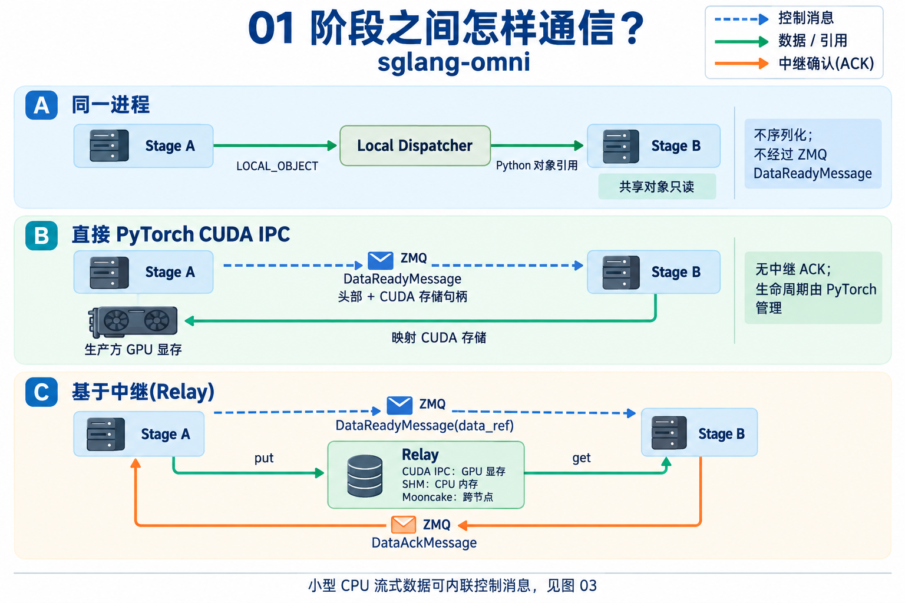
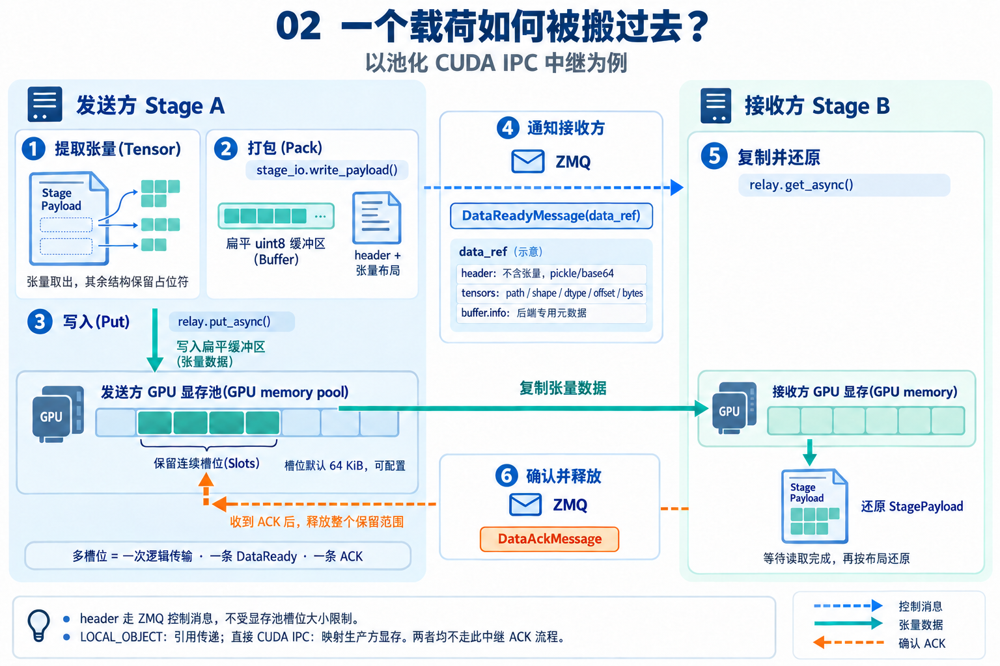
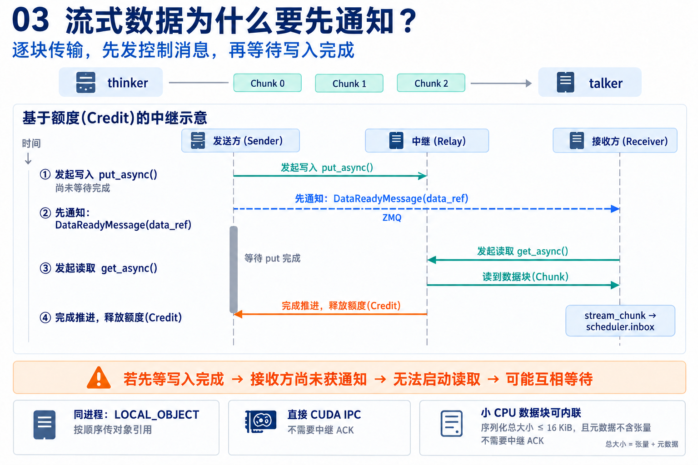
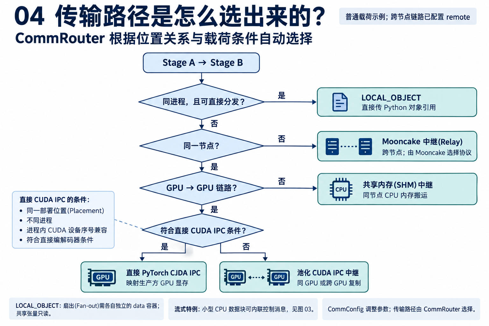

# 6. 通信(Communication)

本文翻译[通信原文](../developer_reference/communication.md)。在 `sglang-omni` 的阶段(Stage)间通信中，ZMQ 负责协调信息和序列化后的控制元数据(Control Metadata)，`sglang_omni.comm` 则定义数据搬运规则。阶段代码根据阶段名称路由，由通信路由器(Comm Router)选择具体路径：同进程对象传递；同一部署位置(Placement)、进程内 CUDA 设备序号兼容时的直接 PyTorch CUDA IPC；同节点其他 GPU 链路的池化 CUDA IPC；本地 CPU 内存(CPU memory)数据搬运使用共享内存(SHM)；已配置的跨节点搬运使用 Mooncake。



## 主要实现入口

| 文件 | 职责 |
|---|---|
| `sglang_omni/comm/data_ref.py` | 定义由 `DataReadyMessage.data_ref` 携带的、具有明确类型的中继数据引用 `DataRef` |
| `sglang_omni/comm/router.py` | 判断位置关系(Locality)，选择传输方式(Transport) |
| `sglang_omni/comm/engine.py` | 面向阶段代码的统一通信接口 |
| `sglang_omni/comm/stage_io.py` | 打包和解包载荷(Payload)及流式张量(Stream Tensor) |
| `sglang_omni/pipeline/control_plane.py` | ZMQ 套接字、msgpack 序列化，以及阶段与协调器(Coordinator)的消息路由 |
| `sglang_omni/pipeline/local_dispatch.py` | 同进程共同部署阶段之间的 Python 对象分发 |
| `sglang_omni/relay/base.py` | 中继(Relay)后端接口和后端注册表 |
| `sglang_omni/relay/cuda_ipc.py` | 发送方拥有的 CUDA GPU 显存(GPU memory)池、槽位分配、数据复制和完成处理 |
| `sglang_omni/relay/{shm,nccl,nixl,mooncake}.py` | 具体中继后端 |
| `sglang_omni/proto/messages.py` | 控制平面(Control Plane)消息类型 |

## 传输模型(Transfer Model)

| 路径 / 传输方式 | 携带内容 |
|---|---|
| 协调 / ZMQ PUSH/PULL | `SubmitMessage`、`DataReadyMessage`、`CompleteMessage`、`StreamMessage`、`ShutdownMessage` 及性能分析器(Profiler)控制消息 |
| 广播协调 / ZMQ PUB/SUB | `AbortMessage` |
| 同进程 / `LOCAL_OBJECT` | 同一操作系统进程内，通过 Python 引用传递完整 `StagePayload` 对象和流式数据块(Stream Chunk) |
| 同部署位置直接 GPU 搬运 / PyTorch CUDA IPC | CUDA 存储句柄，以及普通载荷或流式传输的控制元数据 |
| 同节点池化 GPU 搬运 / CUDA IPC 中继 | 打包后的载荷张量缓冲区、CUDA 流式数据块，以及流式元数据张量 |
| 本地 CPU 搬运 / SHM 中继 | 完整载荷的张量缓冲区，以及不走本地 CUDA 数据通路的流式数据块 |
| 跨节点搬运 / Mooncake 中继 | 经 Mooncake 选择的传输方式搬运完整载荷的张量缓冲区和流式数据块 |

`DataReadyMessage.data_ref` 携带直接 PyTorch CUDA IPC 封装(Envelope)、内联 CPU 流式封装，或具有明确类型的中继 `DataRef`。直接封装包含经 pickle 序列化的载荷头部或流式元数据，以及 PyTorch CUDA 存储句柄；内联 CPU 流式封装包含序列化后的张量及不含张量的元数据。中继 `DataRef` 包含对象 ID、数据种类、传输方式、布局、后端缓冲区引用、张量布局及可选的流式元数据，`RelayOperation.metadata` 存放在 `DataRef.buffer.info` 下。

## 普通载荷流程(Normal Payload Flow)

协调器通过 `SubmitMessage` 将第一个 `StagePayload` 直接提交给入口阶段。此后，阶段间载荷根据链路和载荷情况，使用 `LOCAL_OBJECT`、直接 PyTorch CUDA IPC 或中继传输。

- **直接 CUDA IPC 路径**：`Stage` 提取 CUDA 张量叶子节点，将剩余 `StagePayload` 用 pickle 序列化为普通控制元数据，并通过 PyTorch 的 CUDA 多进程序列化器(Reducer)序列化每个 CUDA 张量，随后发送包含存储句柄的 `DataReadyMessage`。接收方映射生产方分配的 GPU 显存(GPU memory)并恢复载荷，无须中继缓冲区，也没有中继 `DataAckMessage`（生命周期由 PyTorch CUDA IPC 所有权机制管理）。头部属于 ZMQ 控制元数据，大小与池化 CUDA 中继的槽位大小无关。
- **基于中继(Relay)的载荷路径**：
  - ① 发送方向 `CommRouter` 查询链路传输方式，调用 `CommEngine.send_payload(...)`。
  - ② 发送工作线程调用 `stage_io.write_payload()`：递归提取 `payload.data` 中的张量并用占位符替换；将不含张量的 `StagePayload` 用 pickle 序列化，并将张量拼接成一个 `uint8` 缓冲区。
  - ③ 发送方对该缓冲区调用 `relay.put_async()`，再发送 `DataReadyMessage(data_ref=...)`。其中 `DataRef` 包含 `buffer.info`（来自 `RelayOperation.metadata`）、`header`（不含张量、base64 编码的 `StagePayload`）和 `tensors`（路径、形状 Shape、数据类型 Dtype、偏移量和字节数）。
  - ④ 接收方在 `Stage._on_data_ready()` 中调用 `CommEngine.read_payload()`，等待 `relay.get_async()` 完成，恢复张量并交给阶段输入处理器。
  - ⑤ 接收方发送 `DataAckMessage`，发送方随后释放保留的操作；⑥ 若输入汇聚(Fan-in)完成，阶段将 `IncomingMessage` 放入 `scheduler.inbox`。
- **`LOCAL_OBJECT` 同进程路径**：绕过中继和 ZMQ `DataReadyMessage`，发送方调用进程内分发器触发目标阶段的 `receive_local_payload()`，直接按 Python 引用传递投影后的 `StagePayload`。接收方必须将载荷、容器、张量视为只读；扇出(Fan-out)时只有每个投影后的载荷拥有独立 `data` 容器才允许使用 `LOCAL_OBJECT`。请求对象不应在后续阶段继续持有已消费的大体积原始媒体数据。



## 流式传输流程(Streaming Flow)

流式传输用于生产者—消费者链路（如 `thinker` 向 `talker` 传递隐藏状态 Hidden States，或 `talker` 向 `vocoder` 传递编码张量 Code Tensors），统一通过 `CommEngine.send_stream_chunk()` 发送：

- **同节点 GPU 目标**：同一部署位置且命名空间兼容(Namespace-compatible)的进程可通过直接 PyTorch CUDA IPC 封装发送 CUDA 数据块（元数据可含 CUDA 张量和普通内联值，不含 CPU 张量，上限 64 KiB）；同节点其他 GPU 链路使用池化 CUDA IPC 中继（携带 `transport="cuda_ipc"` 和 `chunk_id`）。
- **同进程流式目标**：通过 `LocalStageDispatcher.send_stream_chunks()` 按序发送连续数据块，接收方逐块入队 `stream_chunk` 消息，同样遵循只读与生命周期约束。
- **非进程内流式目标**：若 CPU 张量及元数据序列化后不超过 16 KiB 且元数据不含张量，直接内联放入 `DataReadyMessage`（无须中继 ACK）；否则通过 `write_tensor()` 写入中继，**先发送控制消息，再等待尚未完成的写入操作(Put Operation)**，接收方在 `Stage._on_stream_chunk()` 中读取并入队。此顺序对 NIXL 等基于额度(Credit)的后端至关重要，避免发送方在接收方启动读取释放额度前死锁等待。流结束和错误通过 `send_stream_signal()` 发送。



## 中继接口(Relay Interface)与传输方式选择(Transport Selection)

```python
class Relay:
    async def put_async(self, tensor: torch.Tensor, request_id: str | None = None, dst_rank: int | None = None) -> RelayOperation: ...
    async def get_async(self, metadata: Any, dest_tensor: torch.Tensor, request_id: str | None = None) -> RelayOperation: ...
    def cleanup(self, request_id: str) -> None: ...
    def close(self) -> None: ...
```

`put_async()` 返回的 `RelayOperation.metadata` 放入控制消息，读写操作均提供 `await wait_for_completion(timeout=...)`。CUDA IPC 中继管理归发送方所有的有限容量 GPU 显存(GPU memory)池（默认粒度 64 KiB，可通过 `cuda_ipc_slot_size_kb` 配置），一个张量可预留多个连续槽位并通过一条逻辑 `DataAckMessage` 释放。`CommRouter` 根据位置关系自动推导传输方式：

| 传输方式 | 选择规则 |
|---|---|
| `local_object` | 源阶段和目标阶段位于同一操作系统进程，且载荷符合直接本地分发条件 |
| 直接 PyTorch CUDA IPC | 同一部署位置、不同进程，进程内 CUDA 设备序号兼容，且符合直接编解码器要求 |
| `cuda_ipc` | 未使用直接 PyTorch CUDA IPC 的同节点 GPU 链路；池化中继支持同 GPU 和跨 GPU 搬运 |
| `shm` | 同节点主机/CPU 内存(CPU memory)传输，且所选链路不是 GPU 到 GPU |
| `mooncake` | 被列为远程的跨节点阶段链路；由 Mooncake 选择传输使用的协议 |



## 资源生命周期(Resource Lifetime)

- 发送方写入数据并发送 `DataReadyMessage`，再按后端要求等待写入完成；接收方分配目标缓冲区、等待读取完成、恢复载荷并调用 `relay.cleanup(request_id)`。
- 池化 CUDA IPC 发送方保留完整槽位范围直至收到逻辑 ACK；直接 PyTorch CUDA IPC 依赖 PyTorch 导入存储的生命周期管理；`LOCAL_OBJECT` 无后端清理，依赖使用期间只读。
- 中止请求时调用 `relay.cleanup(request_id)`，阶段关闭时调用 `relay.close()`（如 `shm` 解除共享 CPU 内存块链接 Unlink、NIXL/Mooncake 释放缓冲池额度、NCCL 销毁进程组 Process Group）。
