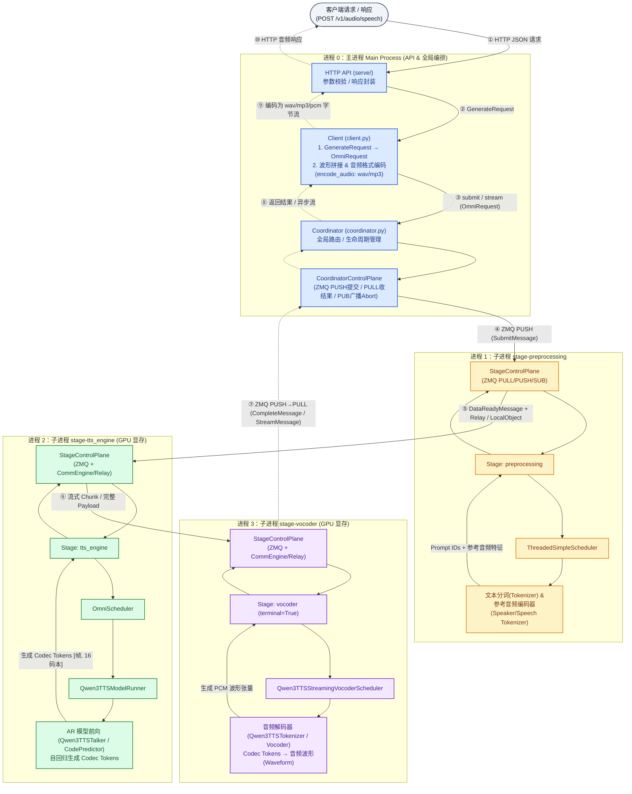
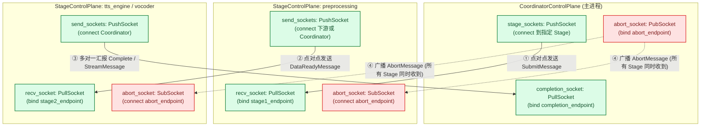
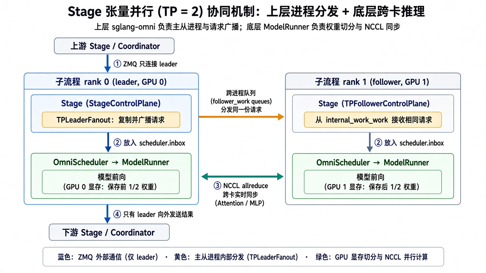
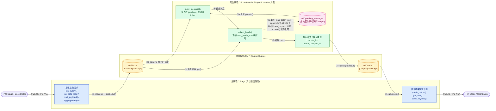

# 8. 请求数据流-qwen3-tts

本文展示 `POST /v1/audio/speech` 在 `sglang-omni`（以 Qwen3-TTS 为例）中的正向请求链路与反向结果链路，涵盖 `HTTP API`、`Client`、`Coordinator`、控制面(`CoordinatorControlPlane` / `StageControlPlane`)、三个 `Stage` 及其内部的调度器(Scheduler)、自回归模型(AR Model)、音频编解码器(Audio Codec / Vocoder)及跨卡张量并行(TP)协同机制。

## 1. 跨进程请求与结果数据流图

为直观区分阶段与进程职责，下图按**各 Stage 独立进程**用不同颜色标出进程边界（Qwen3-TTS 默认同进程布局下，`preprocessing`、`tts_engine`、`vocoder` 三个阶段配置相同的 `process="pipeline"`，共用同一个子进程并通过进程内 `LocalStageDispatcher` 传递对象引用）：

## 2. 各进程与组件职责对照

| 颜色标识 | 所属进程 | 核心组件 | 输入 → 输出（数据形态变化） |
| --- | --- | --- | --- |
| **蓝色** | 主进程 (`Main Process`) | `HTTP API` → `Client` → `Coordinator` ↔ `CoordinatorControlPlane` | 正向：HTTP JSON → `GenerateRequest` → `OmniRequest` → ZMQ `SubmitMessage`；反向：ZMQ `CompleteMessage` → `encode_audio` 编码为 `wav`/`mp3` 字节流 |
| **黄色** | 子进程 (`preprocessing`) | `StageControlPlane` ↔ `Stage` + `ThreadedSimpleScheduler` + 分词/参考编码器 | 原始文本与参考音频 → 文本 Token IDs + 说话人/参考音频特征(`StagePayload`) |
| **绿色** | 子进程 (`tts_engine`) | `StageControlPlane` ↔ `Stage` + `OmniScheduler` + `ModelRunner` + `Qwen3TTSTalker` | 提示特征 → GPU 显存(GPU memory)自回归推理 → 离散音频码本标记(Codec Tokens) |
| **紫色** | 子进程 (`vocoder`) | `StageControlPlane` ↔ `Stage` + `StreamingVocoderScheduler` + `Qwen3TTSTokenizer` | 离散 Codec Tokens → 声码器解码 → 连续 PCM 音频波形(Waveform)经控制面发回 `CoordinatorControlPlane` |

## 3. 控制面底层四种 Socket 区别 (`Push` / `Pull` / `Pub` / `Sub`)

| 组件 | 通信模式 | 连接角色 | 方向与语义 | 本库中的用途 (`control_plane.py`) |
| --- | --- | --- | --- | --- |
| **`PushSocket`** | `PUSH / PULL` 单向流水线 | `connect()` 主动连接目标 | **只发不收（点对点）**：向指定 `endpoint` 推送消息，每条消息只被目标消费一次 | ① `Coordinator` 向 `Stage` 发 `SubmitMessage` ② 上游 `Stage` 向下游发 `DataReadyMessage` ③ `Stage` 向 `Coordinator` 发 `CompleteMessage` |
| **`PullSocket`** | `PUSH / PULL` 单向流水线 | `bind()` 绑定监听地址 | **只收不发（多对一汇聚）**：监听自身 `endpoint`，汇总接收任意多个 `PushSocket` 发来的消息 | ① 每个 `Stage` 持有一个 `recv_socket` 收任务 ② `Coordinator` 持有一个 `completion_socket` 汇总各 `Stage` 结果 |
| **`PubSocket`** | `PUB / SUB` 发布-订阅 | `bind()` 绑定广播地址 | **一对多广播发送**：发布一条消息，所有已连接的 `SubSocket` **同时收到一份拷贝** | `Coordinator` 持有唯一一个 `abort_socket`，向全场广播 `AbortMessage`（中止请求） |
| **`SubSocket`** | `PUB / SUB` 发布-订阅 | `connect()` 订阅广播地址 | **广播接收**：连接 `Coordinator` 的广播地址，后台监听所有广播消息 | 每个 `Stage` 持有一个 `abort_socket`，在 `abort_listener()` 中接收中止信号 |

## 4. Stage 内部张量并行 (TP = 2) 协同机制

**上层 `sglang-omni` 负责拉起多进程与请求分发，底层 `Stage` 内的模型负责真正的跨卡张量并行(TP)计算**（以 `tp_size = 2` 为例）：

- **① 上层 `sglang-omni` 的安排（主从进程拓扑 + 任务同步）**：
  - **进程拆分**：为该 Stage 启动 2 个独立 OS 子进程，`tp_rank=0` 为 **`leader`**（对外接 ZMQ `StageControlPlane`），`tp_rank=1` 为 **`follower`**（挂载 `TPFollowerControlPlane`，不接外部 ZMQ）。
  - **请求广播(`TPLeaderFanout`)**：外部请求只发给 `leader`；`leader` 在入队 `scheduler.inbox` 前，通过跨进程队列(`follower_work_queues`)把同一份请求复制分发给所有 `follower`，保证所有 rank 同时拿到相同的输入；只有 `leader` 把最终输出发往下游 Stage。
- **② 底层 `Stage` 内模型推理的并行处理（NCCL 通信 + 权重切分）**：
  - 每个 rank 进程只加载自己那 `1/2` 的模型权重分片到各自 GPU 显存(GPU memory)。
  - 前向推理(`ModelRunner.forward`)时，2 个 rank 进程同时跑，在每一层 Attention / MLP 内部通过 `torch.distributed` (NCCL `all_reduce`) 实时同步跨卡计算结果。

## 5. Stage-SimpleScheduler 数据流图

单个 `Stage` 内部通过 `self.inbox`（收件箱）与 `self.outbox`（发件箱）两个线程安全队列(`queue.Queue`)，将主线程的**异步网络收发**与后台线程的**耗时计算**解耦；`SimpleScheduler` 内部再用双端队列 `self.pending_messages`(`deque`) 暂存凑批时回退或非计算类的消息（①→⑨）：

- **① → ②（主线程入队）**：`Stage` 收到上游请求（跨进程先经 `read_payload()` 读张量、多路汇聚经 `AggregatedInput` 合并）后，调用 `enqueue()` → `inbox.put()` 放入收件箱。
- **③ → ⑤（后台线程取消息与凑批）**：`next_message()` 优先从 `pending_messages.popleft()` 取（③a），为空才从 `inbox.get()` 取（③b）；`collect_batch()` 继续从 `inbox` 捞消息凑批（④），遇到超 `max_batch_cost` 的请求调 `appendleft()` 塞回队头（⑤a），遇到 `abort`/`admin` 等非计算消息调 `append()` 放队尾（⑤b）。
- **⑥ → ⑨（计算与结果发送）**：凑好 batch 后交由 `compute_fn` / `batch_compute_fn` 计算（⑥），结果 `outbox.put()` 入队（⑦）；主线程 `drain_outbox()` 取出结果（⑧），经 `get_next()` 路由后发往下游 `Stage` 或 `Coordinator`（⑨）。

## 6. Stage-ThreadedSimpleScheduler 数据流图

```mermaid
flowchart LR
    classDef stage fill:#DBEAFE,stroke:#1D4ED8,color:#1E3A8A
    classDef qBox  fill:#FEF3C7,stroke:#D97706,color:#78350F
    classDef sched fill:#DCFCE7,stroke:#15803D,color:#14532D
    classDef pool  fill:#F3E8FF,stroke:#7E22CE,color:#4C1D95
    classDef pend  fill:#FCE7F3,stroke:#DB2777,color:#831843

    subgraph T1 ["主线程：Stage (异步通信外壳)"]
        Recv["接收请求 (on_submit)<br/>read_payload() / AggregatedInput"]:::stage
        Drain["取出结果 (drain_outbox)<br/>get_next() → send_payload()"]:::stage
    end

    subgraph Queues ["跨线程缓冲队列"]
        Inbox[("self.inbox<br/>(CountingInbox)")]:::qBox
        Outbox[("self.outbox<br/>(Queue)")]:::qBox
    end

    subgraph T2 ["后台线程：ThreadedSimpleScheduler (如 preprocessing)"]
        WaitCap["wait_for_capacity()<br/>检查 len(pending) < max_concurrency(8)"]:::sched
        Submit["executor.submit(run_one, msg.data)<br/>提交任务并绑定 finish 回调"]:::sched
        Pending[("self.pending: dict[req_id, Future]<br/>记录运行中任务（用于并发限流与 Abort）")]:::pend
        Pool["ThreadPoolExecutor (8 个工作线程)<br/>并发执行 self.fn (preprocess_qwen3_tts_payload)"]:::pool
        Finish["finish(request_id, future)<br/>线程完成回调，移除 pending"]:::sched
    end

    Upstream(["上游 / Coordinator"]) -->|"① ZMQ / IPC 传入"| Recv
    Recv -->|"② enqueue → inbox.put()"| Inbox

    Inbox -->|"③ 容量未满时 inbox.get()"| WaitCap
    WaitCap -->|"④"| Submit
    Submit -.->|"⑤a 登记 pending[req_id] = future"| Pending
    Submit -->|"⑤b 分发到空闲工作线程"| Pool
    Pool -->|"⑥ 算完触发 add_done_callback"| Finish
    Finish -.->|"⑥ 弹出 pending.pop(req_id)"| Pending

    Finish -->|"⑦ outbox.put(result)"| Outbox
    Outbox -->|"⑧ outbox.get()"| Drain
    Drain -->|"⑨ 发往 tts_engine"| Downstream(["下游 Stage"])
```

