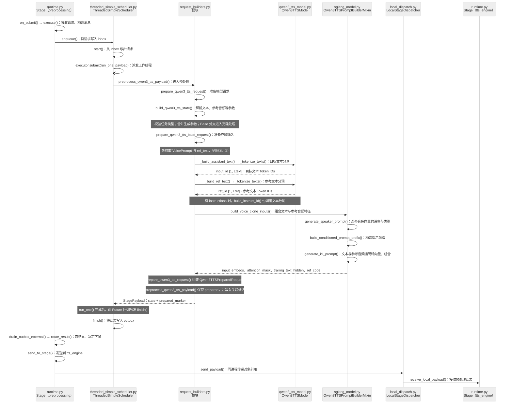
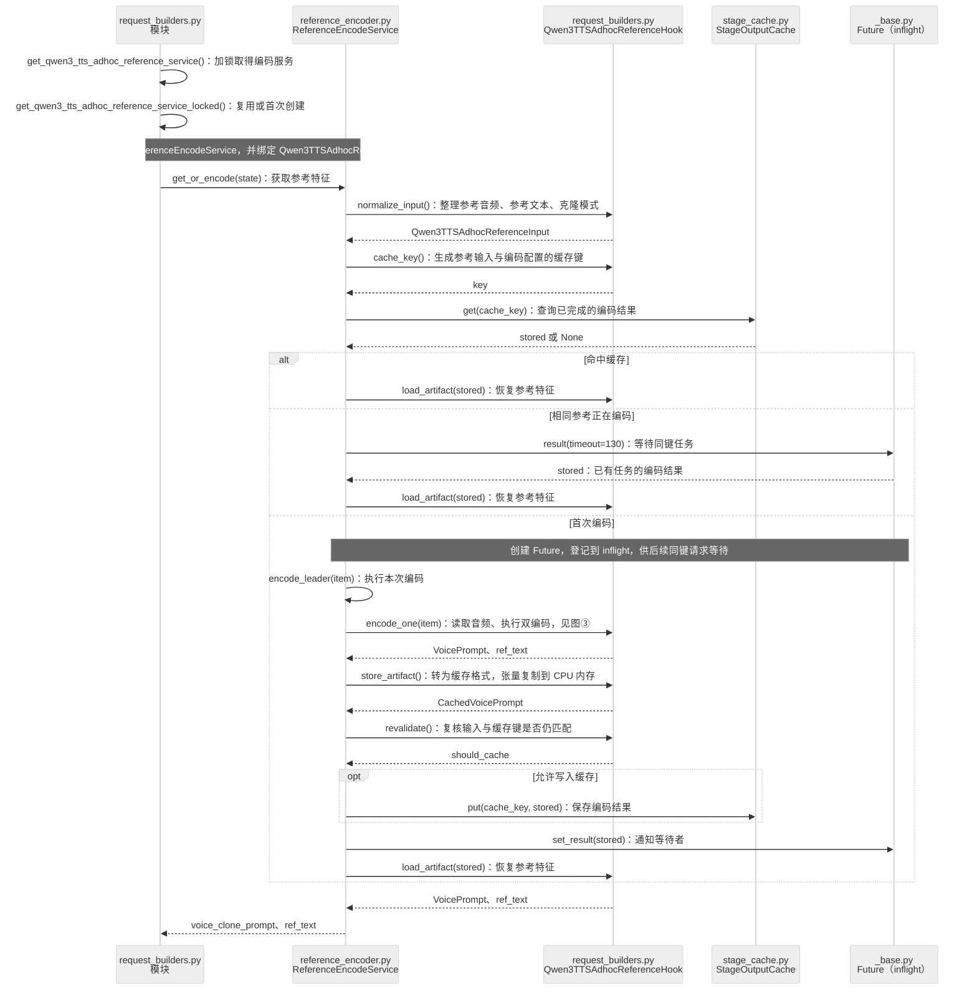
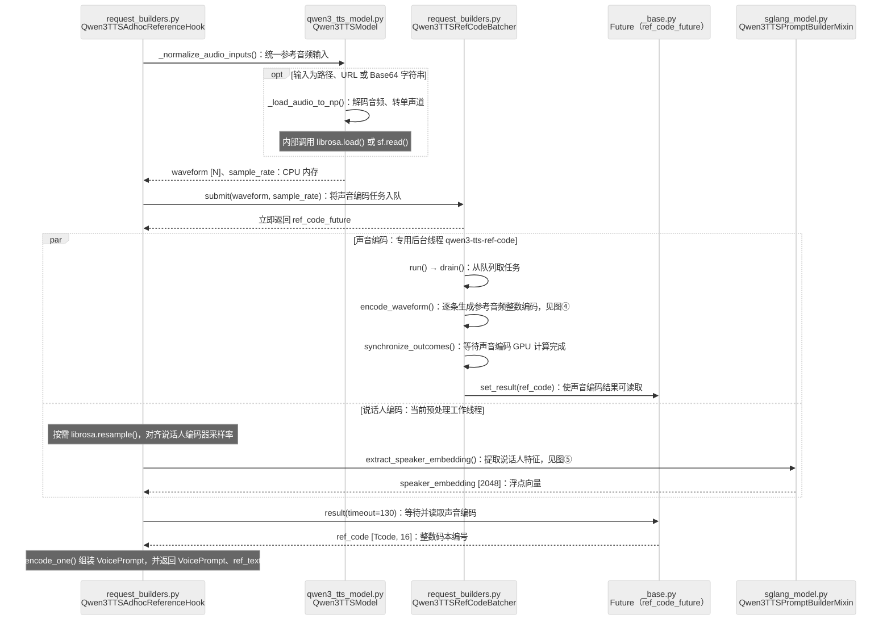
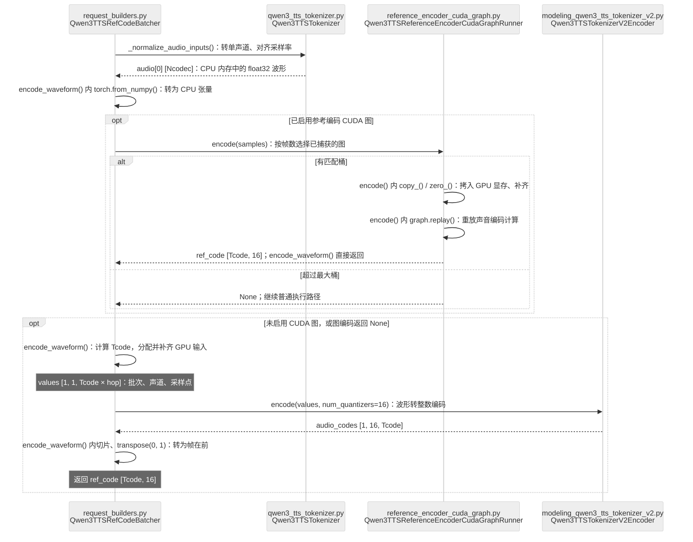
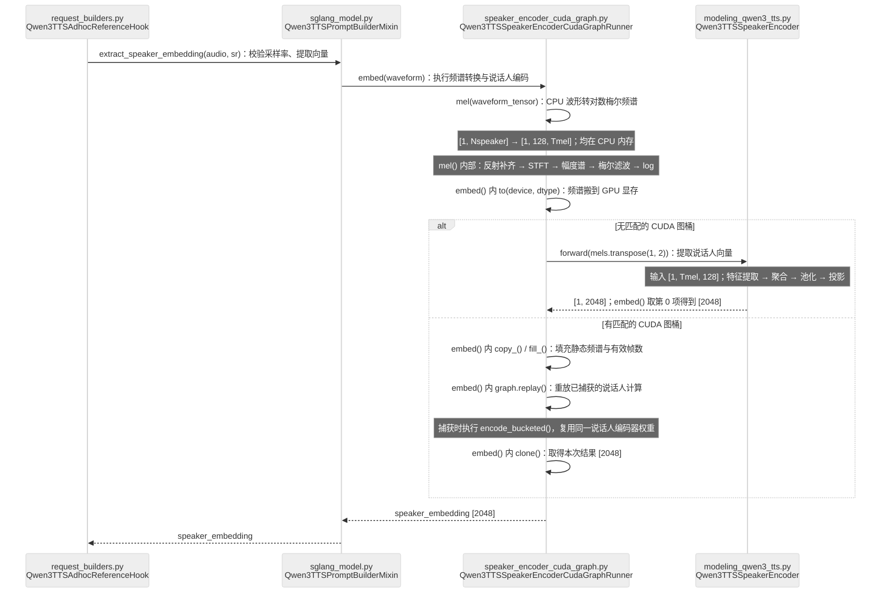

# 8.1 qwen3-tts 数据流：预处理部分

范围：`Qwen3-TTS-12Hz-1.7B-Base`，使用上下文学习（In-Context Learning，ICL）的常规克隆模式，`preprocessing` 与 `tts_engine` 同进程。重点展开代码中已有中文注释的方法。

读图：节点第一行是**文件名**，第二行是**类名或模块名**；实线箭头写**方法名：处理职责**，虚线表示返回数据，开口箭头表示异步派发。同一箭头中的 `→` 表示连续调用，省略中间对象。

`wrapper` 是外部 `qwen_tts` 包的 `Qwen3TTSModel`；`model` 是本项目的 `Qwen3TTSTalker`，下图所用提示构建、说话人提取方法定义在其父类 `Qwen3TTSPromptBuilderMixin`。`Future` 来自 Python 标准库 `concurrent.futures`。

## ① 主链路：接收请求 → 音频特征 → 文本分词 → 交给引擎

启动时，[stages.py](../../sglang_omni/models/qwen3_tts/stages.py) 的 `create_preprocessing_executor()` 使用 `functools.partial()` 绑定预处理函数和默认参数，交给 `ThreadedSimpleScheduler`。下图从请求进入已启动的 Stage 开始。

<!-- mermaid:id=stage_preprocessing -->

`_tokenize_texts()` 经 `processor` 将文本变成整数 Token IDs；`build_voice_clone_inputs()` 再构造向量（Embedding）输入。保存后的核心张量是 `prompt_input_embeds [P, 2048]`、`trailing_text_hidden [R, 2048]`、`ref_code [Tcode, 16]`。P 为提示长度，R 为后续文本长度；Ltext、Lref 包含文本模板标记。

同进程时，CPU 内存（CPU memory）中的 `_PREPARED_REQUESTS` 保存 prepared 对象及其 GPU 显存（GPU memory）张量引用，`prepared_marker` 用于关联。独立进程时改用 `store_prepared_qwen3_tts_payload()`；使用预处理 CUDA 流时记录 `ready_event`，供引擎消费前等待。

## ② 参考缓存：命中复用 → 正在编码则等待 → 首次编码

重点方法：[request_builders.py](../../sglang_omni/models/qwen3_tts/request_builders.py) 的 `prepare_qwen3_tts_base_request()`、[reference_encoder.py](../../sglang_omni/scheduling/reference_encoder.py) 的 `get_or_encode()` / `encode_leader()`。

<!-- mermaid:id=reference_cache -->

图中展开**有缓存键**的临时参考音频链路；`key is None` 时直接 `encode_leader()`，不查写缓存。上传并命名的音色优先查询 `speaker_cache`，未命中则调用同一 Hook 编码。省略错误、超时与中止分支。

缓存命中会跳过两条音频编码，目标文本仍按本次请求分词。`store_artifact()` 负责格式转换，`cache.put()` 才实际存入缓存；`inflight` 中的 Future 用于合并多个相同参考请求。

## ③ 双编码总览：提交声音编码 → 提取说话人向量 → 等待汇合

重点方法：[request_builders.py](../../sglang_omni/models/qwen3_tts/request_builders.py) 的 `Qwen3TTSAdhocReferenceHook.encode_one()`。先 `submit()`，随后在当前工作线程提取说话人向量，最后通过 `ref_code_future.result()` 收集声音编码。

<!-- mermaid:id=parallel_encoders -->

`par` 表示两条工作链可重叠，不保证同时完成。声音编码使用专用 CUDA 流；说话人编码使用当前预处理工作线程的 CUDA 流。`x_vector_only_mode=True` 时跳过声音编码，仅提取说话人向量。

这里的 `ref_code_future` 等待**单个请求中的声音编码**，与图②合并相同参考请求的 `inflight` Future 不同。两项输出都是参考特征，后续由 `tts_engine` 生成目标语音的音频编码。

## ④ 声音编码：波形 → 整数码本编号

重点方法：[request_builders.py](../../sglang_omni/models/qwen3_tts/request_builders.py) 的 `Qwen3TTSRefCodeBatcher.encode_waveform()`；CUDA 图封装在 [reference_encoder_cuda_graph.py](../../sglang_omni/models/qwen3_tts/reference_encoder_cuda_graph.py)。

<!-- mermaid:id=codec_encoding -->

`Tcode = ceil(Ncodec / hop)`；每帧有 16 个码本（Codebook）编号。返回的是整数编号，后续才查表转成向量。`Qwen3TTSTokenizerV2Encoder.encode()` 继承自 `transformers` 的 `MimiModel`；当前链路直接调用该编码器，没有经过 `Qwen3TTSTokenizer.encode()` 包装方法。

## ⑤ 说话人编码：波形 → 对数梅尔频谱 → 音色向量

重点方法：[sglang_model.py](../../sglang_omni/models/qwen3_tts/sglang_model.py) 的 `extract_speaker_embedding()`、[speaker_encoder_cuda_graph.py](../../sglang_omni/models/qwen3_tts/speaker_encoder_cuda_graph.py) 的 `embed()` / `mel()`。

<!-- mermaid:id=speaker_encoding -->

`Tmel` 是梅尔频谱（Mel Spectrogram）帧数，`Tcode` 是音频编码帧数，两者不同。`mel()` 的 128 维表示每帧的频带特征，最终 `[2048]` 向量表示整段参考音频的说话人特征。

日志可沿 `参考音频解码完成` → `声音波形规范化` / `对数梅尔频谱计算完成` → `说话人特征向量提取完成` → `参考编码完成` 定位；双编码日志可能交错。CUDA 图重放不会重新执行被捕获区域中的 Python 日志。
