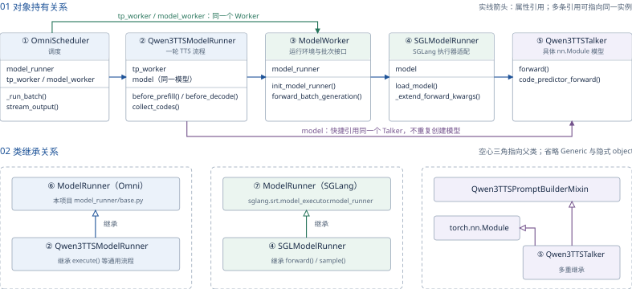
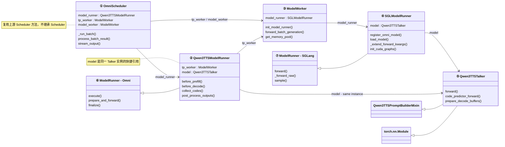
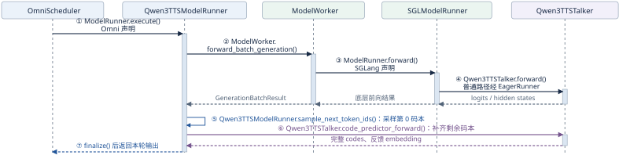
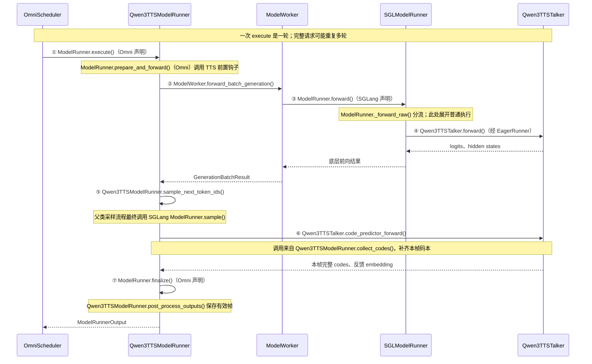

# 8.2 qwen3-tts 推理组件：组合、继承与职责

范围：Qwen3-TTS 的 `tts_engine` 阶段。这些对象在引擎启动时装配，随后跨请求复用。按当前代码说明普通自回归主链路，省略会话、扩散模型和异常分支。打印版为 **两页 A4 横版**：第一页看 UML 类关系，第二页看一轮执行与各类职责。

## 第一页：对象持有与类继承

六个名字对应七个实际类：本项目与 SGLang 各有一个 `ModelRunner`，两者不是同一个类。图中 ①～⑤ 是主体组件，⑥、⑦ 是两个 Runner 基类。

**读图。** 实线箭头表示属性持有的可导航关联；空心三角指向父类。这里的“组合”按属性引用理解，Worker 和模型实例可以被多个对象引用。省略 `Generic[...]` 与隐式 `object` 基类。

**同一实例。** `OmniScheduler.tp_worker`、`OmniScheduler.model_worker` 与 `Qwen3TTSModelRunner.tp_worker` 指向同一个 Worker；外层 Runner 的 `model` 与 `tp_worker.model_runner.model` 指向同一个 Talker。多条引用不代表加载了多份模型。

**继承。** `Qwen3TTSModelRunner` 继承本项目 `ModelRunner`；`SGLModelRunner` 继承 SGLang `ModelRunner`；`Qwen3TTSTalker` 同时继承 `Qwen3TTSPromptBuilderMixin` 与 `torch.nn.Module`。`OmniScheduler` 通过 `__getattr__` 绑定并复用上游 `Scheduler` 的方法，没有继承它；`ModelWorker` 没有自定义父类。

可编辑的 Mermaid UML 类图源码

<!-- mermaid:id=inference_component_classes -->

## 第二页：一次 TTS 中，一轮计算由谁负责

图中参与者是实际对象；箭头上的方法名前缀采用**实际声明方法的类**。`execute()`、`prepare_and_forward()`、`finalize()` 声明在⑥；`forward()`、`_forward_raw()` 声明在⑦。子类实例调用继承方法时，方法中的 `self` 仍是该子类实例。

| 类 | 在一次 TTS 中的职责 | 核心方法及声明位置 |
| --- | --- | --- |
| ① OmniScheduler | 请求入队、组批，反复推进生成；完成后将最终结果放入 outbox。 | 自己声明 `_run_batch()`、`process_batch_result()`、`stream_output()`。 |
| ② Qwen3TTSModelRunner | 准备 TTS 输入，参与采样；调用 Code Predictor 补齐码本，保存 codes 和下一轮反馈。 | 自己声明 `before_prefill()`、`before_decode()`、`collect_codes()`；`execute()` 继承自⑥。 |
| ③ ModelWorker | 启动时初始化设备、并行环境及底层 Runner；请求中执行批次，提供资源管理接口。 | 自己声明 `init_model_runner()`、`forward_batch_generation()`、`get_memory_pool()`。 |
| ④ SGLModelRunner | 将本项目模型接入 SGLang：注册、加载模型，对接 Prefill 输入、CUDA Graph 与 KV 预算。 | 自己声明 `load_model()`、`_extend_forward_kwargs()`、`init_cuda_graphs()`；`forward()` 继承自⑦。 |
| ⑤ Qwen3TTSTalker | 定义模型结构；主前向计算 logits、hidden states；Code Predictor 生成剩余码本。 | 自己声明 `forward()`、`code_predictor_forward()`；主前向内部运行 TextModel 与 DecoderLayer。 |
| ⑥ ModelRunner（Omni） | 定义一轮生成的通用流程：构建输入、调用前后置钩子、前向、采样、整理输出。 | 本项目 `model_runner/base.py`：`execute()`、`prepare_and_forward()`、`finalize()`。 |
| ⑦ ModelRunner（SGLang） | 提供通用前向执行、普通执行与图执行分流，以及 token 采样能力。 | 依赖包 `sglang.srt.model_executor.model_runner`：`forward()`、`_forward_raw()`、`sample()`。 |

**轮次与输出。** 一次 `execute()` 通常是一轮自回归步骤，可处理多条请求，不等于整段语音生成完成。Scheduler 反复推进到结束条件；完成请求由 `stream_output()` 输出最终结果，Stage 交给后续 vocoder 将 codes 转为波形。

**CUDA Graph。** 时序图展开普通主模型前向；命中图时，底层 Runner 执行已捕获的计算，不保证重新进入 Python `forward()`。Code Predictor 也有自己的图路径。

可编辑的 Mermaid UML 时序图源码

<!-- mermaid:id=inference_round_sequence -->

## 源码定位

- [① OmniScheduler](../../sglang_omni/scheduling/omni_scheduler.py)：持有外层 Runner 和同一个 Worker。
- [② Qwen3TTSModelRunner](../../sglang_omni/models/qwen3_tts/model_runner.py)：模型专属钩子、采样及码本收集。
- [③ ModelWorker](../../sglang_omni/model_runner/model_worker.py)：创建底层 Runner、转发前向调用。
- [④ SGLModelRunner](../../sglang_omni/model_runner/sglang_model_runner.py)：继承 SGLang Runner，注册并适配本项目模型。
- [⑤ Qwen3TTSTalker 及 PromptBuilderMixin](../../sglang_omni/models/qwen3_tts/sglang_model.py)：模型计算与提示构建。
- [⑥ ModelRunner（Omni）](../../sglang_omni/model_runner/base.py)：保存 `tp_worker`，并令 `self.model = tp_worker.model_runner.model`。
- ⑦ ModelRunner（SGLang）：依赖包 `sglang/srt/model_executor/model_runner.py`，参考已核对的安装源码。
- [引擎装配](../../sglang_omni/scheduling/engine_factory.py)：将同一个 Worker 传给外层 Runner 与 Scheduler。

PDF：[两页 A4 横版打印版](<pdf/8.2 qwen3-tts 推理组件：组合、继承与职责.pdf>)。图为对应 Mermaid 关系与时序的矢量排版，适合打印；Markdown 中的源码可继续编辑。
