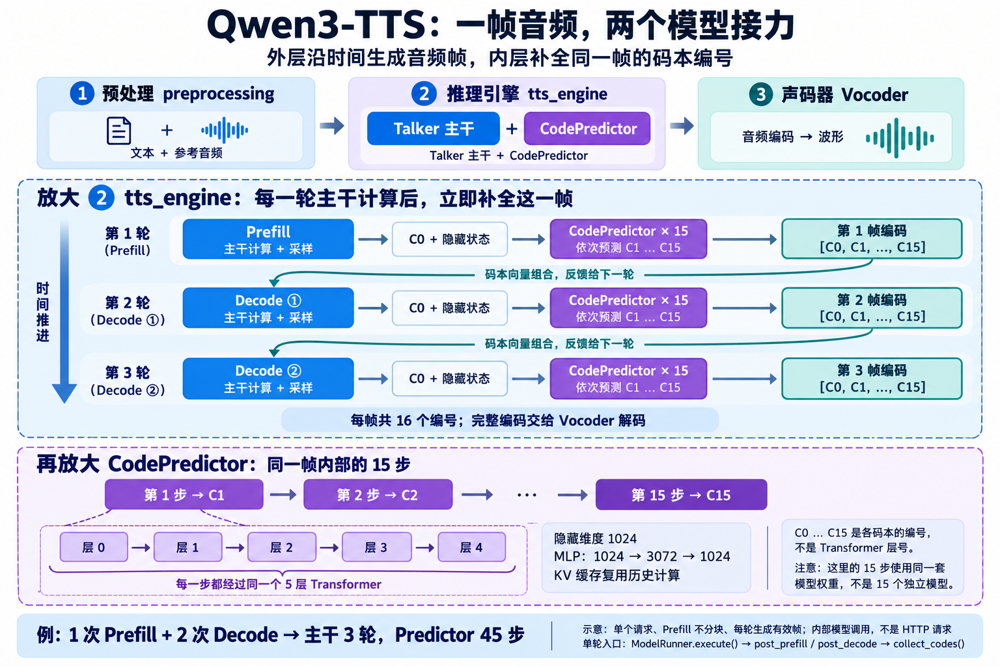

# 8.3 qwen3-tts 主干与 CodePredictor 的逐帧调用

图中每一轮的入口是本项目父类的 [ModelRunner.execute()](../../sglang_omni/model_runner/base.py)，它先完成主干前向计算与采样，再按阶段调用子类的 post_prefill() 或 post_decode()。

子类 [Qwen3TTSModelRunner](../../sglang_omni/models/qwen3_tts/model_runner.py) 在这两个钩子中调用 collect_codes()，继而调用 [Qwen3TTSTalker.code_predictor_forward()](../../sglang_omni/models/qwen3_tts/sglang_model.py)，为当前帧预测剩余 15 个码本编号，因此每一轮主干计算后都会接着执行当前帧的 Predictor。

