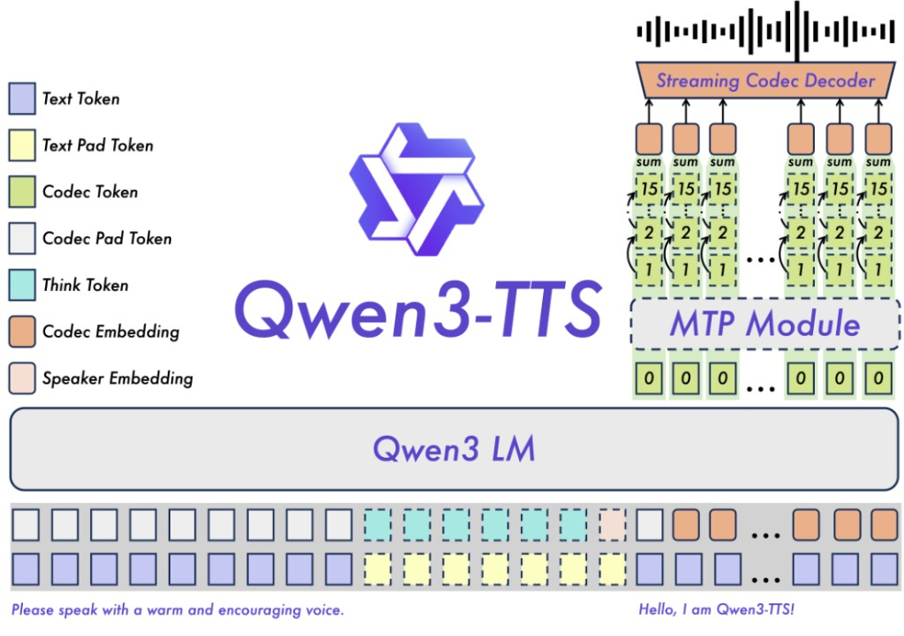
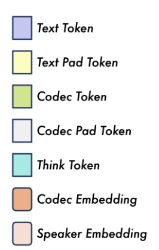
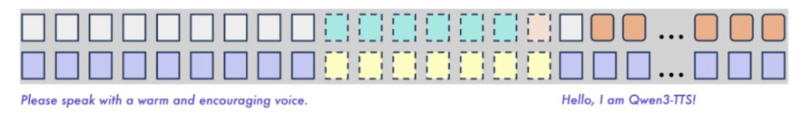
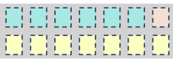
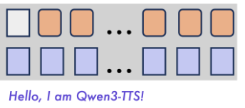
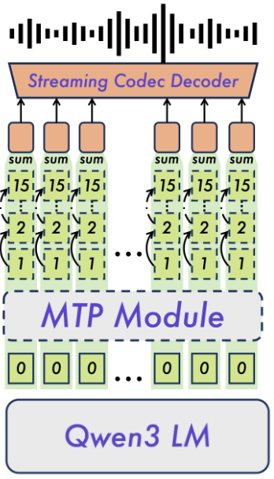
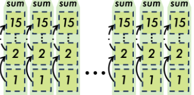
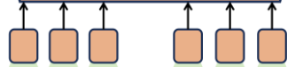
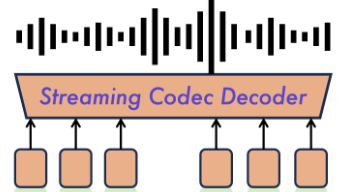

# 8.4 Qwen3-TTS 模型结构与双流对齐详解

本文直接沿用官方架构图中的文字，演示**语音克隆(Voice Clone / ICL)** 如何融合多路输入并逐帧生成语音：

- **风格指令(**`instruct`**，可选)**：++指令文本(++`"Please speak with a warm and encouraging voice."`++)++ —— **描述“怎么说”（语气/风格指令，纯文字、无音频）**
- **参考输入(**`ref_text` **+** `ref_audio`**)**：++参考文本(++`"Hello, I am Qwen3-TTS!"`++)++ + ++参考音频(++`"Hello, I am Qwen3-TTS!"` ++的录音)++ —— 经预处理提取 **1 个音色向量(**`Speaker Embedding`**)** + **多帧参考音频编码(**`ref_code`**：**`R1, R2, ...`**，帧数多于文本 token 数)**
- **目标合成文本(**`text`**)**：++目标文本(++`"你好，我是千问"`++)++（末尾拼 `tts_eos`）→ **最终输出** ++目标语音(++`"你好，我是千问"`++)++

---

## 1. 图例说明（7 类输入/输出单元）

|                                                    |                                                                                                                                                                                                                                                                                                                                                                                                                                                                                                                                                                                                                                                                                                                                                       |
| -------------------------------------------------- | ----------------------------------------------------------------------------------------------------------------------------------------------------------------------------------------------------------------------------------------------------------------------------------------------------------------------------------------------------------------------------------------------------------------------------------------------------------------------------------------------------------------------------------------------------------------------------------------------------------------------------------------------------------------------------------------------------------------------------------------------------- |
|  | - **Text Token（紫色）**：实际文本标记向量（含左侧 ++指令文本(++`"Please speak..."`++)++、右侧 ++参考文本(++`"Hello, I am Qwen3-TTS!"`++)++、++目标文本(++`"你好，我是千问"`++)++ 及 `tts_eos`）。 - **Text Pad Token（黄色）**：文本流填充标记（`tts_pad_embed`），当某位置只有语音控制或音频帧、没有文字时用于占位。 - **Codec Token（绿色）**：单帧离散音频码本编号（每帧含 `0~15` 共 16 个整数 ID，查表求和前是绿色 `Codec Token`，求和后即变成橙色 `Codec Embedding`）。 - **Codec Pad Token（灰白）**：语音流填充/起播标记（`codec_pad` / `codec_bos`），当某位置只有纯文本或刚起播时用于占位。 - **Think Token（青色）**：放在语音流中的**目标语种/方言控制标签**（复用 `<think>...</think>` 括号格式包裹 `language_id`，查音频控制词表）。 - **Codec Embedding（橙色）**：单帧 16 个绿色 `Codec Token` 各自查表并**逐元素求和（**`sum`**）**后的合成音频向量（参考音频帧与生成反馈帧通用）。 - **Speaker Embedding（粉色）**：从 ++参考音频(++`"Hello, I am Qwen3-TTS!"`++)++ 提取的说话人全局音色向量（`ref_spk_embedding`）。 |

---

## 2. 底部双流输入序列与“双流逐位置相加”原则（`build_voice_clone_inputs`）

架构图底部输入序列分为**上下两排**，在送入主干网络 `Qwen3 LM` 前遵循**同位置逐元素相加**原则（合并后在 GPU 显存(GPU memory)中每个时间步仅占 **1 个序列位置**，`shape = [batch_size, 1, hidden_size]`）：

- **上排（语音流 Codec Stream）**：依次排列 `Codec Pad/BOS Token`、`Think Token`、`Speaker Embedding` 及 `Codec Embedding`。
- **下排（文本流 Text Stream）**：依次排列实际 `Text Token` 或占位的 `Text Pad Token`，与上排同位置向量直接相加。

按从左到右顺序，底部双流序列分为以下三段：

### ① 左侧段：描述“怎么说”的纯文字风格指令（`apply_instruct_prefix`，无录音）

- **一句话理解**：这里的 ++指令文本(++`"Please speak with a warm and encouraging voice."`++)++ 是告诉模型 **用什么语气/风格怎么说的纯文字描述（Instruct）**，本身并不是克隆的语音及其对应的文本，因此下排是紫色 `Text Token`，上排只能用灰白 `Codec Pad Token` 占位。

### ② 中间虚线框：语种与说话人音色控制区（`build_conditioned_prompt_prefix`）

- **上排**：青色虚线框为 `Think Token`（目标语种控制前缀），紧跟粉色虚线框 `Speaker Embedding`（从 ++参考音频(++`"Hello, I am Qwen3-TTS!"`++)++ 提取的音色向量）。
- **下排**：这几步是纯语音控制信息、没有对应文字，因此下排全部用黄色 `Text Pad Token`（`tts_pad_embed`）占位并与上排相加。

### ③ 右侧段：++参考音频/参考文本(++`"Hello, I am..."`++)++ + ++目标文本(++`"你好，我是千问"`++)++ 双流对齐区

> 这一步部分同时包括了：1）上边是参考音频信息；2）下边是参考音频文本和 TTS 文本信息

图中右侧省略号 `...` 前后正好对应 **Prefill 参考引导** 与 **Decode 自回归生成**：当 ++参考音频(++`"Hello, I am Qwen3-TTS!"`++)++ 的帧数（设 5 帧 `R1~R5`）多于 ++参考文本(++`"Hello, I am Qwen3-TTS!"`++)++ 的 token 数（3 个 token：`Hello`、`I am`、`Qwen3-TTS!`）时，模型把 ++参考文本(++`"Hello, I am Qwen3-TTS!"`++)++ 与 ++目标文本(++`"你好，我是千问"`++)++ **拼成一条连续文本流**，与语音流从左到右逐位置硬对齐相加：

| 阶段 / 通道                | `pos 0` (Prefill)   | `pos 1` (Prefill)  | `pos 2` (Prefill)       | `pos 3` (Prefill)  | `pos 4` (Prefill)  | `pos 5` (Prefill)  | `pos 6` (Decode)   | `pos 7` (Decode)   | `pos 8` (Decode)   |
| :--------------------- | :-----------------: | :----------------: | :---------------------: | :----------------: | :----------------: | :----------------: | :----------------: | :----------------: | :----------------: |
| **上排：语音流** *(灰白 / 橙色)* | `codec_bos` *(灰白块)* | **参考帧 R1** *(橙色块)* | **参考帧 R2** *(橙色块)*      | **参考帧 R3** *(橙色块)* | **参考帧 R4** *(橙色块)* | **参考帧 R5** *(橙色块)* | **生成帧 G1** *(橙色块)* | **生成帧 G2** *(橙色块)* | **生成帧 G3** *(橙色块)* |
| **同位置相加**              | `+`                 | `+`                | `+`                     | `+`                | `+`                | `+`                | `+`                | `+`                | `+`                |
| **下排：文本流** *(紫色 / 黄色)* | `"Hello,"` *(紫色参考)* | `"I am"` *(紫色参考)*  | `"Qwen3-TTS!"` *(紫色参考)* | `"你好，"` *(紫色目标)*   | `"我是"` *(紫色目标)*    | `"千问"` *(紫色目标)*    | `tts_eos` *(紫色结束)* | `tts_pad` *(黄色占位)* | `tts_pad` *(黄色占位)* |

- **为什么** `pos 0` **上排要先放 1 个灰白块** `codec_bos`**（Beginning of Sequence，音频起播标记）**：
  1. **自回归起播引子**：自回归模型需“输入上一帧音频 → 预测当前帧音频”，第 1 帧音频 `R1` 之前还没有声音，必须用 `codec_bos` 作为起点触发预测。
  2. **让文字比声音领先 1 步**：`pos 0` 下排先放入第 1 个词 `"Hello,"`、上排放 `codec_bos`，模型才能在 `pos 0` **先读到第 1 个词，再预测第 1 帧声音**。
- **核心现象**：因为 ++参考音频(++`"Hello, I am Qwen3-TTS!"`++)++ 的帧数（`codec_bos` + `R1~R5` 共 6 个位置）比 ++参考文本(++`"Hello, I am Qwen3-TTS!"`++)++（3 个 token）长，所以在 Prefill 阶段，++目标文本(++`"你好，"`++、++`"我是"`++、++`"千问"`++)++ 直接顺延垫在参考音频帧 `R3, R4, R5` 下方一起送入模型；从 `pos 6` 开始模型自回归生成的橙色帧 `G1, G2, G3...`，就是 ++目标语音(++`"你好，我是千问"`++)++。
- **为什么采用这种“双流错位叠加（Dual-Stream Overlay）”范式**（CosyVoice 2 / Moshi / Qwen3-TTS 通用设计）：
  1. **支持双向流式（Streaming）**：无需等整句文字输完，上游 LLM 每吐出 1 个字就能垫在当前音频帧下送入 TTS，实现“边进文字边出声音”。
  2. **省掉外部强制对齐器（Forced Aligner）**：文字流提前铺入 KV Cache，模型在每帧靠自注意力（Causal Self-Attention）自己回头寻找当前该读哪个字（软对齐）。
  3. **序列长度减半**：上下直接相加（高维正交子空间经线性层即可解耦），序列长度从 `L_text + L_audio` 降为 `max(L_text, L_audio)`，KV Cache 与计算开销减半。

---

## 3. 主干推理与右上方 16 码本生成栈（对应 `collect_codes`）

|                                                                             |                                                                                                                                                                                                                                                                                                                                                                                                                                                                                                                                                                                                                                                                                                                                                                                                                                                                                                                                                                                                                                                                                                                                                                                                                                                                                                                                                                                                                                                                                                                                                           |
| --------------------------------------------------------------------------- | --------------------------------------------------------------------------------------------------------------------------------------------------------------------------------------------------------------------------------------------------------------------------------------------------------------------------------------------------------------------------------------------------------------------------------------------------------------------------------------------------------------------------------------------------------------------------------------------------------------------------------------------------------------------------------------------------------------------------------------------------------------------------------------------------------------------------------------------------------------------------------------------------------------------------------------------------------------------------------------------------------------------------------------------------------------------------------------------------------------------------------------------------------------------------------------------------------------------------------------------------------------------------------------------------------------------------------------------------------------------------------------------------------------------------------------------------------------------------------------------------------------------------------------------------------- |
|  | 每推进一个时间步（生成 ++目标语音(++`"你好，我是千问"`++)++ 的每一帧音频 `G1, G2...`），自下而上按 6 步完成合成： **1. 主干网络前向 (**`Qwen3 LM` **/** `Qwen3TTSTalkerTextModel`**)**  吃进底部“上排语音 + 下排文本”相加后的单步向量 `[batch_size, 1, hidden_size]`，读取并追加主干 KV 缓存(KV Cache)，输出隐状态 `talker_hidden`。 **2. 预测第 0 层语义码本 (**`layer0_codes`**)**  主干每次只推进 1 个位置，`talker_hidden` 经 `codec_head` 投影到词表 `[batch_size, vocab_size]` 后采样出**第 0 层码本编号**（绿色框 `0`）。 **3. 启动子网络 (**`MTP Module` **/** `Qwen3TTSCodePredictor`**)**  在 `collect_codes()` 中调用 `code_predictor_forward(layer0_codes, talker_hidden)`，将主干隐状态与第 0 码本向量拼成 2 个引导 token 送入子网络。 **4. 帧内 15 步自回归补全残差码本 (**`1 → 2 → … → 15`**)**  `code_predictor_forward_incremental` 循环 15 次，每步用独立的 `lm_head[layer_idx]` 预测当前码本编号，凑齐当前帧 16 个码本 `output_codes` `[batch_size, 16]`。 **5. 16 码本向量求和反馈 (**`sum` **→** `Codec Embedding`**)**  将同帧 `0~15` 共 16 个码本查表并**逐元素相加（**`sum`**）成橙色向量** `summed_embeddings` `[batch_size, 1, hidden_size]`，回填到底部上排作为下一轮主干输入。 **6. 流式声码器还原波形 (**`Streaming Codec Decoder` **/** `vocoder`**)**  每帧生成的 16 个整数码本编号发往 `vocoder` 阶段（`Qwen3TTSTokenizer`），解码还原为顶部连续的 PCM 语音波形（即 ++目标语音(++`"你好，我是千问"`++)++）。 |
