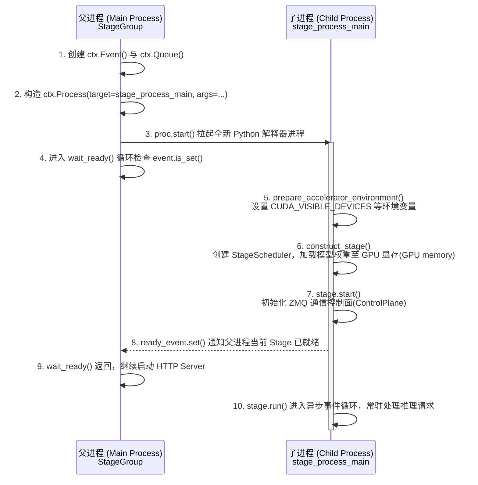

# Python `multiprocessing` 在本库中的使用科普

## 1. 核心概念与 `spawn` 启动模式

- **多进程(Multiprocessing)**：Python 标准库组件，用于启动独立的操作系统子进程(Subprocess)，绕过全局解释器锁(GIL, Global Interpreter Lock)，并隔离各阶段(Stage)的运行环境与 GPU 上下文(GPU Context)。
- **`spawn` 模式 vs `fork` 模式**：
  - `fork`（Linux 默认）：直接克隆父进程的 CPU 内存(CPU memory)状态；若父进程已初始化 PyTorch/CUDA，克隆会导致 GPU 上下文损坏或死锁。
  - `spawn`（本库采用）：启动一个全新的 Python 解释器子进程，不复制父进程的 CPU 内存(CPU memory)状态，仅将 `args` 参数通过 `pickle` 序列化(Serialization)传递给子进程，对 GPU 显存(GPU memory)和 CUDA 初始化安全。

---

## 2. 核心语法与本库代码对照

| 组件 / 语法 | 作用 | 本库对应位置与用途 |
| --- | --- | --- |
| `ctx = multiprocessing.get_context("spawn")` | 获取 `spawn` 模式的进程上下文(Process Context) | `sglang_omni/pipeline/mp_runner.py:702`，全局统一用 `spawn` 创建进程与同步原语 |
| `event = ctx.Event()` | 跨进程事件信号量(Event) (`set()` / `is_set()`) | 子进程加载完模型后调 `event.set()`，通知父进程已就绪 |
| `queue = ctx.Queue()` | 跨进程安全队列(IPC Queue) | 子进程启动异常时，用 `put(traceback)` 将报错信息传回父进程 |
| `proc = ctx.Process(target=fn, args=(...))` | 构造进程对象（此时未启动，仅绑定入口函数与参数） | `sglang_omni/pipeline/stage_workers.py:399`，绑定入口 `stage_process_main` |
| `proc.start()` | 向操作系统申请拉起新进程，在子进程中执行 `fn(*args)` | `sglang_omni/pipeline/stage_workers.py:415`，真正启动子进程 |
| `proc.is_alive()` / `proc.join()` | 检查子进程是否存活 / 等待子进程退出 | `wait_ready()` 巡检存活状态，`shutdown()` 回收进程 |

---

## 3. 本库中的构造与启动流程

### ① 父进程构造并拉起子进程 (`StageGroup.spawn`)

对应文件：`sglang_omni/pipeline/stage_workers.py`

```python
for spec in self.process_specs:
    event = ctx.Event()  # 创建跨进程就绪信号量(Event)，用于子进程通知父进程初始化完成
    startup_error_channel = ctx.Queue()  # 创建跨进程队列(IPC Queue)，用于子进程向父进程回传启动异常栈
    proc_name = process_name(spec)  # 生成进程名称，如 stage-preprocessing
    proc = ctx.Process(
        target=stage_process_main,  # 指定子进程启动后执行的入口函数
        args=(spec, event, startup_error_channel),  # 经 pickle 序列化传给 target 函数的参数元组
        name=proc_name,  # 设置 OS 进程名
        daemon=True,  # 设为守护进程(Daemon Process)，随父进程退出而终止
    )
    try:
        extra_env = (
            process_env_overrides.get(spec.process_name)
            if process_env_overrides is not None
            else None
        )
        # 临时打补丁修改环境变量与 CPU 亲和性(CPU Affinity)，让子进程继承
        with patched_spawn_env(spec, extra_env=extra_env), spawn_affinity(spec):
            self._process_start_attempts.add(spec.process_name)  # 记录已尝试启动的进程名
            proc.start()  # 真正拉起 OS 子进程，子进程开始执行 stage_process_main(*args)
    except Exception:
        close_queue(startup_error_channel)  # 启动失败时关闭跨进程队列，释放资源
        raise
    self._processes.append(proc)  # 保存进程句柄，供后续巡检(is_alive)和销毁(join/terminate)
    self.ready_events.append(event)  # 保存就绪信号量，供 wait_ready() 阻塞等待
    self.startup_error_channels.append(startup_error_channel)  # 保存错误队列，供启动失败时读取报错详情
```

### ② 父子进程执行时间线


