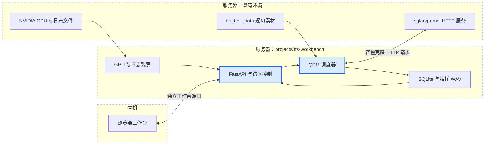
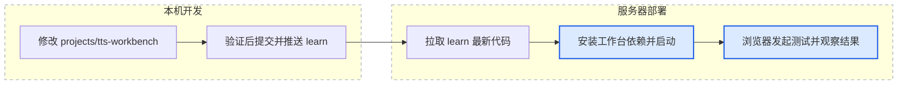

# TTS 测试工作台

一个放在 `projects/` 下的独立应用：使用现有逐句素材请求 TTS HTTP 服务，控制 QPM 和运行时长，统计结果、试听抽样音频，并查看服务器 GPU 和日志。

**本机开发，服务器拉取本仓库后独立部署。** 工作台有自己的 Python 环境与启动命令，仅通过 HTTP 连接已经运行的 TTS 服务。安装本目录即可，无需安装父项目的 PyTorch、CUDA 或模型依赖。

当前 T4 服务器 `43.128.249.5` 的推理环境、模型下载和服务管理入口见 [T4 部署说明](../../deploy/t4/README.md)，公网工作台使用 `http://43.128.249.5:8081`。

## 功能与边界

| 功能 | 行为 |
| --- | --- |
| 测试素材 | 读取根目录 `tts_test_data` 中 5 个配音单元、272 句的中文参考音频和中英文文本；按配音单元选择，包含所选单元全部角色 |
| 生成方式 | 固定 Qwen3-TTS Base、中文参考 → 英文配音；非流式 `POST /v1/audio/speech`，返回 WAV |
| 调度 | 顺序请求或乱序请求；均按 `60 / QPM` 秒发起请求，前一请求未完成也继续发送；时长预设 10 分钟、1 小时和 24 小时，可自定义至 7 天 |
| 素材抽样 | 顺序从所选素材第一句开始，按原顺序循环。乱序逐次随机抽样，重复样本概率默认 20%，可调 0%–100%；按该概率从本任务已选过的样本中抽取，否则从未选样本中抽取，池内等概率。首条随机选择；未选样本耗尽后持续从已选池抽取。0% 先遍历全部再重复，100% 重复随机首条；失败请求也计入已选，不继承历史任务 |
| 任务名称 | 默认“模型名称 + 递增序号”，例如 `qwen3-tts-1.7b-base-001`；可手动修改。每次创建任务分配序号，按模型独立计数，重启或清理结果不重置；页面预览不占用序号 |
| 任务筛选 | 请求记录的任务下拉列表按创建时间倒序（最新在前）；也支持按名称部分匹配搜索全部历史任务，叠加只看失败及分页 |
| 请求统计 | 成功、失败、超时、截断、进行中、跳过调度、发起/成功 QPM、素材覆盖、成功请求平均/P50/P95/P99 时延 |
| 试听与详情 | 点击试听直接播放结果；详情展示 HTTP 方法、URL、请求 JSON 和参考音频，支持展开完整 Base64；标题及关闭按钮固定在弹窗顶部；每条请求右侧可按服务 request_id 下载全部日志，缺少服务 ID 时按钮禁用 |
| 保留 | 全部请求记录保存到 SQLite，相同请求体共用一份快照；每句首次成功音频保留一份，每任务音频默认最多 1 GiB |
| 监控 | 同一主机所有可见 NVIDIA GPU 每 2 秒采样，实时卡片区分显存已用/总量、显存占比、估算余量、计算利用率、温度和功耗，并附口径；计算与显存图表显示最近 30 分钟，采样保存在 SQLite，关闭页面继续记录；日志按需搜索，结果默认折叠，可展开格式化详情；每页默认上限 2,000 行，可调为 1–30,000 行，最多 100 条完整记录；日志可最大化，按还原或 Esc 退出 |
| 请求日志 | 新日志后台增量写入独立的 `logs.sqlite3`（WAL）。按 request_id、关键字、代码位置组合搜索全部保留记录，按新到旧稳定翻页；点击位置筛选，点击请求 ID 查看完整链路。记录展开后保留全部内容，JSON 自动格式化。只保留最近 20,000,000 行，按完整记录删除更早数据及全文/请求索引；下载范围同样受保留期限制 |
| 清理 | 清理某个已结束任务或所有已结束任务的记录、事件、GPU 记录与抽样音频；素材和原始服务日志保持只读 |

页面固定使用 `qwen3-tts-1.7b-base` 和 `English`，不再提供模型、语言或最大并发选择。历史任务原有配置仍可读取，旧的 `max_concurrent_requests` 字段仅兼容读取，不再参与调度。

页面使用全宽工作区，通过内容区标签按顺序切换运行概览、GPU 监控、请求记录、服务日志；不再显示左侧导航和顶部重复的四张统计卡片。配置区可收起为窄边栏，保留已填写的内容并记住收起状态。日志页不自动刷新或滚动；点击搜索、刷新、翻页才读取数据，不打断已展开的记录。查询失败明确展示错误，由用户重试。配置区只提供顺序/乱序两种运行方式，移除角色与单句选择、台词/参考音频预览；乱序时显示重复概率设置，任务概览保留实际抽样配置。

重复概率描述的是工作台的选材行为，不等于模型的缓存命中率。每个任务的已选池独立，但模型可能仍缓存此前其他任务编码过的参考音频。

所有选中素材都按原始音频字节和文本发送，不按音频长短、文本内容、哈希或转写待复核标记过滤，也不裁剪、补长或自动重试。十五条扩窗参考音频保留原始 `reference_text_needs_review` 标记，仅供观察，不影响发起请求。短音频等输入由模型自行处理，失败后继续后续请求并保留错误。

<!-- mermaid:id=workbench_architecture -->


## 本机开发

需要 Python 3.10+ 和 `uv`。在父仓库根目录执行：

```bash
cd projects/tts-workbench
uv sync --frozen --extra dev
uv run --frozen tts-workbench \
  --api-base http://127.0.0.1:8000 \
  --data-dir ../../tts_test_data \
  --results-dir ./results/local \
  --host 127.0.0.1 \
  --port 8081 \
  --allow-unauthenticated-local
```

浏览器打开 `http://127.0.0.1:8081`。这条命令仅启动工作台；本机没有 TTS 服务时，页面会显示服务未就绪，请求如实记录连接失败。没有 `nvidia-smi` 时明确显示 GPU 指标不可用。

如果本机直接连接远程 TTS HTTP 地址，GPU 和日志仍属于**运行工作台进程的主机**。要查看服务器资源，应把工作台也部署到对应 GPU 服务器。

`--allow-unauthenticated-local` 只允许回环地址监听，也适用于服务器上的 SSH 转发入口。免登录启动时需移除进程的 `TTS_WORKBENCH_PASSWORD` 环境变量。公网或局域网监听默认需要访问口令，也可通过 `--allow-unauthenticated-public` 明确启用免登录直连。

## 服务器部署

服务器复用已经 clone 的仓库。工作台代码与父仓库一起提交、推送和拉取，依赖在本子目录单独安装。

<!-- mermaid:id=workbench_delivery -->


### 准备服务日志

在服务器父仓库根目录创建日志目录：

```bash
mkdir -p logs
```

按原有方式启动 TTS 服务时，把原启动命令的标准输出和标准错误追加到 `logs/tts.log`。例如，将下面的 `你的模型启动参数` 换为服务器正在使用的参数：

```bash
PYTHONUNBUFFERED=1 sgl-omni serve 你的模型启动参数 >> logs/tts.log 2>&1
```

如果服务已经保存日志，直接用该文件的绝对路径配置工作台。日志查看支持轮转、截断和后续文件创建；旧进程没有保存过的输出无法补读。

### 安装与后台启动

先在服务器父仓库根目录更新代码：

```bash
git switch learn
git pull --ff-only origin learn
cd projects/tts-workbench
uv sync --frozen
mkdir -p results
```

如果服务器无法访问 PyPI 文件下载站，可导出相同锁定版本并从腾讯镜像安装：

```bash
uv venv --python python3.10
mkdir -p results
uv export --frozen --no-dev --no-emit-project \
  --format requirements-txt --output-file results/server-requirements.txt
uv --no-config pip install --python .venv/bin/python \
  --index-url https://mirrors.cloud.tencent.com/pypi/simple \
  --require-hashes -r results/server-requirements.txt
uv --no-config pip install --python .venv/bin/python --no-deps \
  --index-url https://mirrors.cloud.tencent.com/pypi/simple -e .
```

工作台自带独立 `tool.uv` 配置，避免继承父项目的模型依赖覆盖规则。镜像安装仍使用锁文件中的版本及包哈希，不修改模型虚拟环境。

通过 SSH 转发访问时，工作台只监听服务器回环地址，浏览器无需登录。后台启动时移除进程继承的旧工作台口令，按实际情况替换 TTS 地址和日志路径：

```bash
nohup env -u TTS_WORKBENCH_PASSWORD .venv/bin/tts-workbench \
  --api-base http://127.0.0.1:8000 \
  --data-dir ../../tts_test_data \
  --results-dir ./results/server \
  --log-file ../../logs/tts.log \
  --host 127.0.0.1 \
  --port 8081 \
  --allow-unauthenticated-local \
  > ./results/workbench.log 2>&1 &
```

在本机建立 SSH 转发：

```bash
ssh -N -L 127.0.0.1:8081:127.0.0.1:8081 root@服务器地址
```

然后直接访问 `http://127.0.0.1:8081`，无需用户名或密码。这个本机地址只是服务器工作台的访问入口，调度、TTS 请求、GPU 读取、日志读取和结果保存全部发生在服务器。SSH 连接断开只会断开页面访问，不会停止服务器上的测试任务；重新建立转发即可继续查看。

如果需要通过 `http://服务器公网IP:8081` 免登录直连，使用下面的启动方式，并在实例关联安全组中添加 TCP 8081 入站允许规则：

```bash
nohup env -u TTS_WORKBENCH_PASSWORD .venv/bin/tts-workbench \
  --api-base http://127.0.0.1:8000 \
  --data-dir ../../tts_test_data \
  --results-dir ./results/server \
  --log-file ../../logs/tts.log \
  --host 0.0.0.0 \
  --port 8081 \
  --allow-unauthenticated-public \
  > ./results/workbench.log 2>&1 &
```

该模式下，能连接 8081 的访问者可以发起测试、清理测试结果及读取工作台日志。安全组来源可按需要设置为访问端 IP/CIDR；来源 `0.0.0.0/0` 表示允许所有 IPv4 地址访问。

如需口令访问，设置 `TTS_WORKBENCH_PASSWORD`，移除免登录参数和 `env -u TTS_WORKBENCH_PASSWORD`，并将监听地址改为 `0.0.0.0`；用户名为 `workbench`。需要 HTTPS 时可在工作台前部署反向代理。

如 TTS 服务需要 Bearer Key，设置服务器环境变量 `TTS_API_KEY` 后启动。密钥只用于后端请求，不返回浏览器，也不写入任务配置。页面所有请求同源，目标 TTS 地址在进程启动时配置。

更新工作台时，先停止当前测试并等请求结束，再停止工作台进程、拉取代码、重新安装依赖并启动。浏览器关闭不影响后台任务；工作台进程退出会停止调度。异常退出后再次启动，旧任务标为中断，不自动恢复发请求。

更新公共日志组件后也需要重启 TTS 服务。先等原进程退出、确认配置端口可以实际绑定，再使用原有启动命令；仅检查没有监听进程还不够，旧连接的 `TIME_WAIT` 也可能让启动器判定端口占用，需要等待连接释放。建议在启动命令前设置 `SGLANG_OMNI_STRICT_PORT=1`，避免启动器在端口暂时占用时悄悄改用随机端口，导致工作台连接失效。

一个结果目录只能由一个工作台进程持有，不要对该应用启用多个 Uvicorn worker。

## 指标与测试语义

- **QPM**：每分钟 HTTP 请求数，一句台词是一条请求。默认 10 QPM，即每 6 秒发起一次。
- **发起间隔**：仅按 QPM 调度，不设置工作台并发上限或 HTTP 连接数上限；先前请求未结束也继续发起。实际排队、限流和失败由模型服务返回并记录。调度器本身落后时跳过过期时机，不集中补发。
- **完整一轮**：按所选单元和原始行号顺序，每句请求一次。持续模式循环同一顺序，直到到达时限。
- **停止/到时**：停止新请求，等待在途请求结束或超时，因此最终结束时间可能比设定时长晚一个单请求超时窗口。
- **成功**：HTTP 2xx，且服务没有报告显式截断或生成异常；不检查音频质量、最短时长或逐帧完整性。`X-Finish-Reason: length` 计为截断失败；未知结束原因单独计数。HTTP 成功不等于音频可播放或内容正确，这些问题通过原始抽样结果和试听发现。
- **失败兜底**：HTTP 错误、连接失败、超时、服务报告截断/异常都保留明细和失败计数，继续后续请求，不自动重试。失败不纳入平均/P50/P95/P99 时延、成功 QPM 或成功音频总时长。参考文件无法读取时记录该句失败，不阻止其他句子；目录边界、参数类型、访问认证和资源上限仍保留。
- **音频时长**：只尝试读取成功响应的元数据用于展示，不作为通过条件；读不到就留空，不把请求改判失败，不将未知时长假装成零秒。API 同时提供可读取时长的成功样本数与总时长。
- **时延**：从开始 HTTP 请求至完整响应读完，包含服务排队与网络传输，不包含本地音频抽样写盘。P50/P95/P99 对成功请求使用 nearest-rank 统计；失败和调度延迟在明细中查看。
- **发起 QPM / 成功 QPM**：前者是最近至多 60 秒内发起次数折算的频率，用于观察施加的负载；后者仅计算窗口内成功完成的请求，不包含失败。首分钟按已运行时间计算，早期可能波动。健康检查和模型查询不计入压测请求数。请求总数包括各次尝试及其本地读取失败，错误来源在明细中区分。
- **GPU 利用率**：设备级计算活跃程度，不代表精确 SM 占用率或 FLOPS。指标包含该主机相同 GPU 上其他进程的影响。
- **结果保留**：原始参考音频只读。所有实际请求逐条持久化；每句只保存首次成功音频，超出配额仍统计。单响应最多接收 32 MiB，防止异常返回耗尽工作台内存。
- **完整配音单元**：本工作台按句测试全部选中素材，保留行号与角色；音频试听是逐句结果，不自动混音、拼接成原时间轴或生成视频。
- **HTTP 参数详情**：新请求在发送前保存实际 JSON 值和目标 URL，认证信息不保存。重复请求体去重存储，清理任务后回收不再引用的快照。旧记录没有快照时明确标为按历史配置和当前素材还原，不冒充原始记录。
- **日志搜索**：每页默认 2,000 行，可调至 30,000 行；完整记录超过预算时仍整条返回，避免截断正文。每页最多 100 条，分页固定搜索快照，新增日志不会导致重复或漏页。关键字通过 SQLite FTS5 trigram 索引搜索，支持中文；少于三个字符时使用全文子串扫描，建议结合 request_id 或代码位置缩小范围。代码位置支持完整 `文件.py:行号` 或文件名前缀。后台每 2 秒追读日志；未写完的记录等写完整后入库。
- **日志容量**：数据库总行数上限 20,000,000，清理时同步删除记录、request_id 关联与全文索引，保留导入偏移以防重新导入已清理内容。SQLite 会复用释放页，文件不随每次删除立即缩小；不做在线全库 VACUUM。此上限仅约束日志库，不删除测试任务和音频，也不限制独立的原始服务日志文件。部署本版本时按用户要求清空旧日志库与原始日志，不执行旧库迁移。SQLite 需支持 FTS5 trigram（当前服务器已具备）。
- **服务请求 ID**：服务公共格式化器在第二行输出 `request_id=speech-...`，与响应 `X-Request-Id` 对应；共享模型批次显示 `request_ids=[...]`，启动等无请求上下文日志显示 `request_id=-`。上下文在 HTTP、Coordinator 提交/接收、Stage 接收/分发/结果路由、串行/并行调度线程、AR 批次、参考编码和声码器入口绑定并自动释放，无需逐条修改日志调用。公共访问日志过滤器忽略 `GET /health` 和 `GET /v1/models` 的 HTTP 200 记录，保留失败检查及推理请求访问日志。

## 目录与接口

```text
projects/tts-workbench/
  pyproject.toml / uv.lock       独立依赖与锁文件
  tts_workbench/
    app.py / cli.py             HTTP 工作台与启动命令
    config.py / dataset.py      配置与只读素材索引
    runner.py / storage.py      后台调度与持久化
    speech.py / records.py      HTTP 响应读取与记录类型
    monitor.py                 GPU、健康检查、日志跟随
    static/                    页面、样式、交互与图表
  tests/                       隔离的接口和调度验证
  results/                     已被 Git 忽略
    server/state.sqlite3       任务、请求、事件、GPU 数据
    server/audio/<任务ID>/      抽样生成音频
    logs.sqlite3               服务日志全文、请求 ID 索引和增量读取检查点
    workbench.log              工作台自身日志
```

接口统一在 `/api/workbench` 下：

| 方法与路径 | 用途 |
| --- | --- |
| `GET /dataset`、`GET /service` | 素材清单、目标健康与模型列表 |
| `GET /runs`、`POST /runs` | 最近任务、创建任务 |
| `GET /runs/{id}` | 设置、汇总、时间趋势与事件 |
| `POST /runs/{id}/stop` | 停止发起新请求 |
| `GET /runs/{id}/requests` | 请求分页，支持 `offset`、`limit`、`failures_only` |
| `GET /requests/{request_id}/http` | 实际 HTTP 入参快照，旧记录明确标注还原来源 |
| `DELETE /runs/{id}`、`DELETE /runs/completed` | 清理单次或全部已结束任务 |
| `GET /gpu?run_id=...` | 当前 GPU 与对应任务采样历史 |
| `GET /requests?task_name=...` | 按任务名称部分匹配搜索全部历史请求，支持分页与仅失败筛选 |
| `GET /task-name` | 预览下一个默认任务名称，创建任务时才分配序号 |
| `GET /logs?cursor=...&limit=2000&request_id=...` | SQLite 历史及增量游标；可选 request_id、scope=all/system/inference；完整块查询，返回 matched_lines 总行数；默认 2,000 行，显示上限 30,000 |
| `GET /logs/search?request_id=...&keyword=...&location=...&page=35&snapshot=...&order=asc` | 全部匹配记录按日志时间排序（asc 从早到晚，desc 从晚到早，同秒按记录 ID），再按页码取数；返回 page、total_pages、snapshot；底部可跳页、到首页和末页，每页最多 100 条且遵守行数预算，超长单条保持完整。切换排序重新搜索，翻页保留快照 |
| `GET /logs/download?request_id=...` | 下载 SQLite 保留范围内该请求的全部完整记录，不受每页行数限制 |
| `GET /audio/{request_id}`、`GET /references/{line_id}` | 已抽样生成音频、已知素材音频 |

修改接口需要 `X-Workbench-Client: 1` 请求头，浏览器页面已自动处理。回环地址与 SSH 转发模式免登录；配置访问口令时，页面和接口统一使用 HTTP Basic 认证。新增请求时，空筛选列表表示全部素材。页面提交 `mode: "duration"`，`sample_order` 为 `sequential` 或 `random`，`repeat_probability` 使用 0–1 小数（默认 0.2），两项配置一并保存到任务 SQLite。旧任务缺少抽样配置时按顺序读取；接口仍兼容旧 `once`、`single` 模式及素材筛选，`single` 必须明确选择一个 `line_id`。

日志头当前只有时分秒；归档按原始记录顺序识别跨午夜的时间回绕，生成可索引的时间顺序，不伪造原始日志未提供的日期。旧归档首次升级时补建时间索引，后续重启复用。日志页码由服务端按记录数和行数预算计算，加载时禁用翻页按钮，避免重复点击累计出错误页码。

## 验证

```bash
uv sync --frozen --extra dev
uv run --frozen pytest -q
node --check tts_workbench/static/app.js
node --check tts_workbench/static/charts.js
node --check tts_workbench/static/controls.js
node --check tts_workbench/static/views.js
node --check tts_workbench/static/requests.js
node --test tests/frontend.test.cjs
```

自动化检查中的音频和 HTTP/GPU 替身只用于验证协议与失败处理，不会出现在真实工作台数据中，也不代表模型已经完成生成。

服务器验收使用实际服务：选择素材与较短的自定义时长，分别执行顺序/乱序请求；核对选材顺序与重复行为、参数快照、返回 ID 与日志第二行相符、抽样 WAV 可以播放，以及成功/失败计数、GPU 和服务日志。1 小时或 24 小时稳定性以服务器实际完成的任务记录为准。

GPU 口径依据 [NVIDIA SMI 文档](https://docs.nvidia.com/deploy/nvidia-smi/index.html#utilization)：计算利用率是设备内部采样周期内至少一个计算内核运行的时间比例，不等于 CUDA 核心占比；显存占比按已用容量除以总容量计算。两项趋势均覆盖最近 30 分钟，缺少采样的时段留空，所有卡片都针对整张设备。
