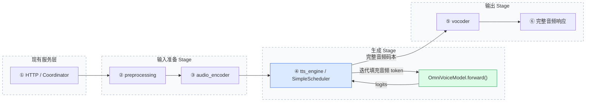

# OmniVoice 原生接入技术方案

本文保存已确认的接入方案，并按 2026-10-24 的实现状态更新；启动命令、请求示例与验证环境见 [OmniVoice 使用说明](../../../docs/cookbook/omnivoice.md)。

## 1. 目标与边界

仅修改 `sglang-omni`，以 `main` 为基础，在 `feat/omnivoice-native-tts` 分支实现；OmniVoice、SGLang 参考仓库保持只读。依据：[TTS 接入指南](../../../docs/developer_reference/tts_model_integration.md)、[流水线说明](../../../docs/developer_reference/pipeline.md)、[AuK 实现](../../../docs/cookbook/auk.md)。

- 原生分阶段接入：服务端组织预处理、参考编码、生成和解码，不调用官方整段 `generate()`。
- 首版支持一条参考音频＋参考文本的音色克隆、完整音频响应、微批处理(Micro-batching)和官方长文本分段。
- OmniVoice 使用扩散语言模型式迭代生成，发布配置为 8 个音频码本；借鉴 AuK 非自回归调度，复用现有 TTS 接口与评测规范。
- 优先保证正确性；流式输出、CUDA Graph、张量并行(TP)、无参考 TTS 和 VoiceDesign 暂不支持。

## 2. 模块与执行链路

| 模块 | 实现职责 |
|---|---|
| `preprocessing` | 读取媒体，映射语言，执行官方文本／参考音频预处理，形成类型明确的状态。 |
| `audio_encoder` | 用 HiggsAudioV2TokenizerModel 编码参考，得到 `[8, 参考帧数]`，估算目标长度并准备分段。 |
| `tts_engine` | SimpleScheduler 组批；双向注意力、无分类器引导(CFG)、置信度排序和逐轮去掩码，输出 `[8, 目标帧数]`。 |
| `vocoder` | 解码码本为波形，按官方方式拼段、调整音量和淡入淡出，交给现有响应编码器。 |

模型复用 Transformers 的 Qwen3 主干及 PyTorch SDPA，保持官方权重名称；关闭自回归 KV cache，显式传入完整双向注意力掩码。默认单 GPU、同一流水线进程、主干 FP16；参考编码与解码共享一份 FP32 编解码器(Codec)，阶段间保留 GPU Tensor 的设备位置。

默认批大小 1，可配置增大；按生成配置分组，处理不同长度的 padding，每个请求使用独立随机数生成器并保持结果对应关系。固定输入和计算形状可复现，不承诺跨精度或批次形状逐位一致。

沿用官方超过约 30 秒触发分段、目标约 15 秒一段的策略，各段复用参考音色，返回一份完整波形。码本数、帧率、采样率从检查点读取，不写死；超出上下文且无法继续分段时明确报错，不截断文本。

复用取消机制，在迭代及分段边界检查，取消后不返回半成品，不新增跨请求音色缓存。日志记录 request_id、阶段耗时、生成步数和形状，不打印整段波形、Base64 或大 Tensor。

## 3. 文件清单

以下新增模型文件均位于本目录；仓库级路径以仓库根目录为基准。

| 类型 | 文件 | 内容 |
|---|---|---|
| 新增 | `__init__.py`、`config.py` | 能力声明、architecture=`OmniVoice`、EntryClass、四阶段配置与单参考约束。 |
| 新增 | `hf_config.py`、`payload_types.py` | 检查点／生成参数、类型化阶段状态、Tensor 与 usage 交接。 |
| 新增 | `request_builders.py` | 解析参考格式、语言、速度和阶段参数，转换现有请求。 |
| 新增 | `model.py` | 文本／音频向量组合、Qwen3 主干、输出头及兼容权重加载。 |
| 新增 | `generation.py` | CFG、迭代去掩码、独立随机数、微批和长文本分段。 |
| 新增 | `audio.py` | 共享 Codec、参考编码、波形解码与官方音频前后处理。 |
| 新增 | `text.py`、`duration.py`、`lang_map.py`、`LICENSE` | 必要官方文本算法、时长估算、语言映射及授权。 |
| 新增 | `stages.py` | 调度器工厂、阶段交接、设备设置、错误与取消处理。 |
| 新增 | `examples/configs/omnivoice.yaml`、`docs/cookbook/omnivoice.md` | 可运行配置、使用说明、评测命令与版本记录。 |
| 修改 | `pyproject.toml`、`docs/basic_usage/tts.md` | 添加 pydub，保留核心依赖版本；增加模型入口。 |
| 修改 | `sglang_omni/serve/openai_errors.py` | 将 OmniVoice 请求参数错误映射为 HTTP 400。 |
| 修改 | `benchmarks/eval/benchmark_tts_seedtts.py` | 增加模型 profile，关闭 AR engine 透传，默认不发 max_new_tokens。 |
| 新增／修改 | 第 5 节测试文件 | 算法、阶段、请求、官方对齐和评测参数回归。 |
| 待校准后修改 | `tests/test_model/tts_ci_config.py` | GPU 全量质量结果通过后再登记非流式预设和实测阈值。 |

无需修改通用注册器、OmniScheduler 或 SGLang 模型运行器。

## 4. 公共接口与参数

复用 `POST /v1/audio/speech`：必需 `input` 和一条 `ref_audio + ref_text` 或 `references[0]`；复用 `language`、`speed`、`seed`、`response_format`，仅支持 `stream=false`。参考文本必填，不自动启动 ASR，不额外过滤短音频；编码失败正常返回错误。

`stage_params.tts_engine`：`num_step=32`、`guidance_scale=2`、`t_shift=0.1`、`position_temperature=5`、`class_temperature=0`、`layer_penalty_factor=5`、`denoise=true`、可选 `duration`、`audio_chunk_duration=15`、`audio_chunk_threshold=30`。显式 duration 优先于 speed 估算；最终时长还受静音处理、拼接和 padding 影响。

`stage_params.preprocessing.preprocess_prompt` 控制参考预处理；`stage_params.vocoder` 接收 `postprocess_output`、`pad_duration`、`fade_duration`。不接受 AR 专属采样参数；缺失 Codec 直接报错，不自动替换版本。

## 5. 测试与验收

| 层级 | 文件／入口 | 验证内容 |
|---|---|---|
| 无 GPU 单测 | `tests/unit_test/omnivoice/test_request_builders.py`、`test_config.py` | 参考格式、参数覆盖、语言、速度／时长、模型发现及阶段配置。 |
| 算法单测 | 同目录 `test_generation.py` | CFG、双向掩码、padding、去掩码、随机数隔离及分段顺序。 |
| 阶段单测 | 同目录 `test_stages.py` | 请求对应、失败隔离、取消、Codec 共享与不同长度解码。 |
| 官方对齐 | `tests/test_model/test_omnivoice_parity.py` | 固定版本，比较文本 token、参考码本、目标长度、单步 logits、生成码本及波形。 |
| 评测回归 | `tests/unit_test/benchmarks/test_tts_seedtts.py` | OmniVoice 不收到 AR 参数，其他模型行为不变。 |
| 完整质量／性能 | `benchmark_tts_seedtts`、`test_tts_ci.py` 非流式阶段 | WER、CER、音色相似度、UTMOS、吞吐、时延、RTF 和峰值 GPU 显存。 |

验收顺序：单测和逐阶段对齐 → SeedTTS 中英文各 32 条冒烟 → 完整 split（英文 1,088 条）→ 固定环境三轮、并发 1/2/4。官方与接入版使用相同检查点、样本、参数、ASR 和归一化；英文 WER、中文 CER，阈值按现有 apply_wer_slack 规则校准。保留成功／失败／跳过记录，失败不混入成功时延统计，也不从覆盖率报告消失。

## 6. 当前交付状态

核心实现提交 `76cd9523`；71 项单测／回归通过。CPU FP32 的四项真实权重对齐通过，波形最大绝对误差为 0；正式 CLI 与 HTTP 全链路返回 WAV，三个并发请求成功且日志确认微批大小 2。官方参考源码固定为 `08be0b4ccbac3e13e374e86fbfead4b4cac343e2`，检查点哈希见使用说明。

尚未部署服务器，未完成 GPU 对齐、全量 WER/CER、质量指标和性能校准；CPU 验证不能代替这些结果。后续按本机开发、提交推送、服务器拉取的流程，在独立环境和端口验证，不影响其他服务，不编造 CI 阈值。
