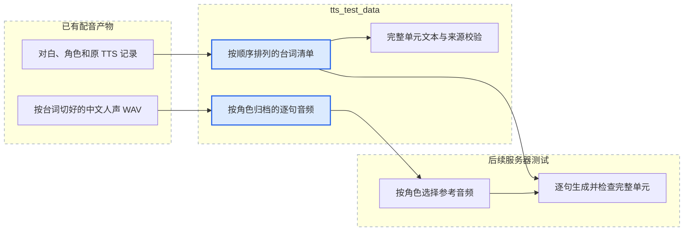

# 甄嬛传逐句 TTS 测试数据

整理日期：2026-10-17。

本目录保存 **5 个已经处理过的配音单元、共 272 条台词**。每条都包含现成的中文原声参考 WAV、中文台词、英文台词、角色和时间戳。一个上集或下集配音片段算一个单元；每个单元的原始对白列表全部保留。

这里的“完整一集”指一个已处理配音单元的全部逐句素材，不是约 45 分钟的电视剧原片。音频直接复制自原项目 `episode_cache/<episode>/tts_segments/line_XXXX.wav`，没有重新裁剪、重采样、降噪或运行 TTS。英文合成结果 `line_XXXX_result.wav` 未作为参考音频混入。

## 数据清单

| 配音单元 | 台词数 | 单元内角色数 | 台词最后结束位置 | 逐句参考音频累计时长 |
| --- | ---: | ---: | ---: | ---: |
| [E35 下集](E35_lower/manifest.json) | 58 | 2 | 120.97 秒 | 73.34 秒 |
| [E36 上集](E36_upper/manifest.json) | 47 | 2 | 101.78 秒 | 60.52 秒 |
| [E36 下集](E36_lower/manifest.json) | 60 | 5 | 135.78 秒 | 78.80 秒 |
| [E37 上集](E37_upper/manifest.json) | 54 | 2 | 149.92 秒 | 76.74 秒 |
| [E37 下集](E37_lower/manifest.json) | 53 | 2 | 115.78 秒 | 78.00 秒 |
| 合计 | **272** | — | **624.23 秒** | **367.40 秒** |

“台词最后结束位置”是已处理片段时间轴上的最后一句结束时间，不代表电视剧原片时长。逐句音频不包含台词之间的全部间隔，所以累计约 6 分 7 秒；5 个单元的上述时间轴长度合计约 10 分 24 秒。

所有参考 WAV 均为 **24,000 Hz、单声道、16 位 PCM**。按角色分目录，原始行号保持不变。

## 目录与对应关系

```text
tts_test_data/
  README.md
  manifest.json                 # 5 个单元的入口和数量汇总
  source_files.json             # 每个复制文件的来源与 SHA-256
  validation.json               # 本次完整性检查结果
  SHA256SUMS                    # 整包校验值
  E35_lower/                    # 其余 4 个单元结构相同
    manifest.json
    lines.jsonl                 # 按原对白顺序排列，一行 JSON 对应一句
    speakers.json               # 角色描述及其全部 line_id
    text_zh.txt                 # 全单元中文，每行一句
    text_en.txt                 # 全单元英文 TTS 文本，每行一句
    audio/
      甄嬛/line_0000.wav
      皇上/...
    source/
      analysis.json             # 原角色识别、台词与翻译结果
      characters.json           # 原角色注册表
      asr_result.json           # 原 ASR 结果
      tts_result.json            # 原 TTS 记录，仅用于核对最终英文文本
```

`lines.jsonl` 和各级清单中的数据文件路径统一相对于 **tts_test_data 根目录**。例如 `E35_lower/audio/甄嬛/line_0000.wav`。来源绝对路径只作追溯，复制到服务器后无需访问本机原目录。

`source/` 文件是原文件的原样副本，其中保留的旧结果路径属于原项目，不是本数据包的执行入口；真正读取数据时使用 `lines.jsonl` 的 `audio_path`。

<!-- mermaid:id=processed_dialogue_data -->


## 逐句字段

| 字段 | 含义 |
| --- | --- |
| `line_id` | 全数据包唯一的台词 ID，例如 `E35_lower_0000` |
| `unit_id` / `line_index` | 配音单元及其从 0 开始的原始行号 |
| `speaker` / `speaker_id` | 原角色名及单元内角色 ID |
| `text_zh` | 原分析结果中的中文台词，对应中文原声 |
| `text_en` | 原分析结果中的英文翻译，可能带词汇高亮中括号 |
| `text_en_tts` | 旧 TTS 记录中实际使用的英文，已包含原流程的重译和标记清理 |
| `start_ms` / `end_ms` | 台词在已处理配音片段中的时间，单位毫秒 |
| `audio_path` / `audio_sha256` | 现成中文参考音频的包内路径及字节校验值 |
| `reference_duration_ms` | 根据 WAV 实际帧数计算的参考音频时长 |
| `reference_start_ms` / `reference_end_ms` | 原参考音频在已处理片段中的实际截取窗口 |
| `reference_window_source` | 窗口依据：原台词时间戳或已有日志中的扩窗记录 |
| `reference_text_needs_review` | 是否扩窗，需要核对参考文字能否覆盖整段参考音频 |
| `source_dialogue_index` | 在 `source/analysis.json` 的 `dialogue` 数组中的位置 |

`text_zh.txt` 逐行对应 `text_zh`；`text_en.txt` 逐行对应 `text_en_tts`。文本文件不插入角色名或注释，因此可作为整个配音单元的文本输入。涉及多角色生成时，以 `lines.jsonl` 中的角色和顺序为准。

角色 ID 只在单元内有意义，本包给它加上单元前缀以防冲突。保留“甄嬛”“莞嫔”等原角色名，不自动推断跨单元的同一人物关系。`speakers.json` 可按角色找到该单元全部台词。

## 参考音频与测试边界

- 原项目的 `line_XXXX.wav` 从已分离的人声轨提取，作为原 TTS/音色克隆流程的参考；不是本次生成的音频。
- 保留了各单元全部台词，没有只挑短句或好听的样本。最后选取的 5 个单元都有完整的音频、中文、英文、角色和顺序对应关系。
- **15 条短台词的参考音频在原流程中扩展到了 500 毫秒。** 本包保留原音频和原台词，扩窗起止来自原 `workflow.log`，并标记 `reference_text_needs_review=true`。实际参考音频可能多出邻近声音，不能默认 `text_zh` 已逐字覆盖扩窗后的全部内容。其余 257 条的音频时长与标注台词窗口一致，但仍未逐条人工听审。
- 英文 `text_en_tts` 是跨语言合成的目标文字，不能当作中文参考音频的转写。中文克隆实验可用 `text_zh` 作目标文字；需要准确参考转写的模型应先复核扩窗条目。
- `start_ms` / `end_ms` 保留原单元时间轴。按角色归档不改变台词顺序；后续整单元测试应按 `line_index` 排序，并单独处理原有停顿和重叠关系。
- 本包只准备测试输入，不宣称新模型已完成克隆、长文本合成或整单元效果验证。实际生成在服务器按项目正式入口执行；本次没有运行高光剪辑、ASR、配音或推理任务。
- 这是业务台词清单格式，并非可直接传给 SeedTTS `--meta` 的 `meta.lst`；后续测试程序需要按上述字段读取。

## 来源与筛选记录

用户指定的工作树为 `/Users/dugenkui/.codex/worktrees/4bec/ai_dubbing`；本次检查发现现有配音缓存实际在 `/Users/dugenkui/workspace/ai_dubbing/test_data/测试输出`。

| 单元 | 实际来源运行目录 | 原缓存标识 |
| --- | --- | --- |
| E35 下集 | `english_learning_E35下_20260727` | `ep35120` |
| E36 上集 | `english_learning_E36上_重剪_20260727` | `ep36120` |
| E36 下集 | `english_learning_E36下_重剪_20260727` | `ep36120` |
| E37 上集 | `english_learning_E37上_v6_20260726` | `ep37120` |
| E37 下集 | `english_learning_E37下_重剪_20260727` | `ep37120` |

上下集会复用同一个 `epNNNNN`，因此本包以 `unit_id` 区分，不能仅用旧缓存标识去重。

初选的 E35 上集未纳入：原数据有一条英文为空，末句参考音频比台词标注窗口短约 575 毫秒。已改用完整性检查通过的 E37 下集，没有修改或补造源项目数据。

源项目 `core/step5_tts.py` 明确将 `line_XXXX.wav` 作为原中文参考片段；本包用原分析的数组下标匹配同名文件，使用 `tts_result.json` 的 `index` 核对角色、时间和实际英文。原始文本和音频均保留，新增字段只用于索引、来源和完整性说明。

## 校验与同步

已检查 272 个 WAV 的全部 PCM 帧、格式、时长和来源 SHA-256；检查 272 行台词的顺序、角色、非空文本，以及每行与原分析和旧 TTS 索引的一一对应。结果记录在 [validation.json](validation.json)。原样复制文件的源路径和校验值见 [source_files.json](source_files.json)。

完整复制本目录到服务器后，在该目录执行：

```bash
sha256sum -c SHA256SUMS
```

包内 `.gitignore` 仅为这些已整理的 WAV/TXT 放开根仓库的通用忽略规则，便于后续提交和服务器同步。本次整理本身不包含 Git 提交、推送或服务器部署。
